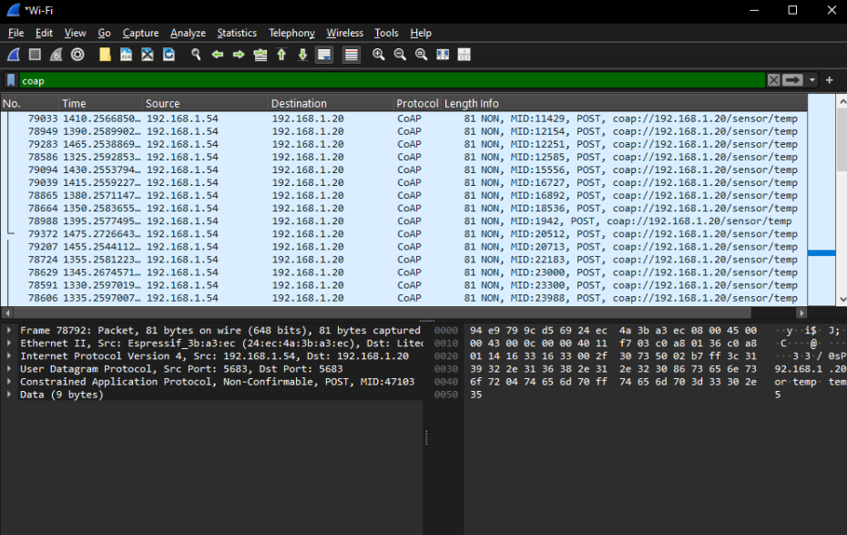

# BÀI THỰC HÀNH 13 — GIAO THỨC CoAP

**Sinh viên:** Trịnh Văn Quynh  
**Nội dung ảnh:** Gửi nhiệt độ bằng CoAP **NON POST** và quan sát bằng Wireshark.  
**Code bổ sung:** Node.js server, client ESP32/ESP32-S3, client Python, proxy mô phỏng mất phản hồi và test tích hợp.

> Ảnh thực hành và code bổ sung là hai nguồn khác nhau: ảnh là kết quả sinh viên cung cấp; mã trong bộ này được soạn thêm để thực hiện lại và mở rộng bài. Không coi ảnh là bằng chứng các mã mới đã chạy trên chính ESP của sinh viên.

## 1. Mục tiêu

- Đọc phương thức POST, loại thông điệp NON, MID, địa chỉ và cổng từ gói CoAP.
- Gửi dữ liệu qua UDP tới `/sensor/temp`.
- So sánh CON/NON khi mất phản hồi.
- Thử Polling, Observe và Block2 ở các mục mở rộng.

## 2. Phân tích ảnh thực hành



*Hình 1. Wireshark lọc coap; danh sách hiển thị nhiều NON POST tới tài nguyên /sensor/temp.*

### 2.1. Thông tin đọc được

| Trường | Giá trị / quan sát |
|---|---|
| Giao diện capture | Wi-Fi |
| Display filter | `coap` |
| Frame đang mở trong Packet Details | `78792` |
| Kích thước frame | `81 bytes` — toàn frame, không phải riêng nhiệt độ |
| IP nguồn | `192.168.1.54` |
| IP đích | `192.168.1.20` |
| Giao vận | UDP |
| Source port / destination port | `5683 / 5683` trong frame đang mở |
| Loại thông điệp | Non-Confirmable — NON |
| Phương thức | POST |
| MID của frame đang mở | `47103` |
| URI xuất hiện trong danh sách | `coap://192.168.1.20/sensor/temp` |
| Mục Data | `9 bytes` |
| Nội dung dữ liệu nhìn thấy trong phần byte/ASCII | `temp=30.5` |

Frame 78792 là số gói trong capture; MID 47103 là mã thông điệp CoAP. Không dùng hai số này thay nhau. Một số dòng danh sách có MID lặp, nhưng chỉ nhìn ảnh chưa đủ kết luận chúng là retransmission: cần đối chiếu endpoint, thời gian và byte nội dung. NON không có cơ chế tự retransmit/ACK của CON ở tầng thông điệp.

### 2.2. Nhận xét kết quả trong ảnh

- Có các POST đi từ thiết bị phát `.54` tới server `.20`.
- `/sensor/temp` là đường dẫn tài nguyên, không phải MQTT topic.
- Hai cổng đều là 5683 trong lần thử này; client CoAP nói chung vẫn có thể dùng cổng nguồn khác.
- Phần danh sách đang chụp chỉ cho thấy các request; chưa thấy response hoặc log server lưu nhiệt độ.
- Chưa có gói CON, Observe hoặc Block2 trong ảnh, nên chưa dùng ảnh này để kết luận đã thực nghiệm đủ 13.1–13.3.

## 3. Các tệp code kèm theo

| Tệp | Vai trò |
|---|---|
| [code/server.cjs](code/server.cjs) | Node.js CoAP server: nhận POST, trả GET, Observe và Block2 |
| [code/esp32_coap/esp32_coap.ino](code/esp32_coap/esp32_coap.ino) | Firmware mẫu cho ESP32/ESP32-S3 Arduino |
| [code/esp32_coap/config.example.h](code/esp32_coap/config.example.h) | Mẫu cấu hình Wi-Fi, server và chế độ bài thử |
| [code/client.py](code/client.py) | Client PC để kiểm tra trước khi dùng board |
| [code/loss_proxy.py](code/loss_proxy.py) | Bỏ response đầu để quan sát retry |
| [tests/test_coap.py](tests/test_coap.py) | Kiểm tra server/client trên loopback |
| [tests/results.log](tests/results.log) | Log chạy test của bộ code này |

Server chỉ dùng module có sẵn của Node.js, client Python chỉ dùng thư viện chuẩn. Không cần npm install hoặc pip install cho các script này. Firmware dùng WiFi/WiFiUDP thuộc Arduino core ESP32, không cần coap-simple.

**Dữ liệu mẫu:** firmware gửi chuỗi cố định `temp=30.5` để dễ đọc gói. Đây là dữ liệu thử, không phải giá trị DHT đo thật. Muốn dùng cảm biến cần thay phần tạo payload bằng giá trị đọc thực tế.

## 4. Chạy thử ngay trên PC Windows

Cần có Node.js và Python. Giải nén toàn bộ bộ bài, mở thư mục `code`, gõ `powershell` trên thanh địa chỉ File Explorer rồi Enter.

### 4.1. Khởi động server

Terminal 1:

```powershell
node .\server.cjs
```

Mặc định server nghe `127.0.0.1:5683`. Giữ cửa sổ mở. Code server này không tạo giao diện website; không mở port 5683 trong trình duyệt như một trang HTTP.

### 4.2. Gửi NON POST tương ứng kiểu gói trong ảnh

Terminal 2, cũng tại thư mục `code`:

```powershell
python .\client.py post-non --payload "temp=30.5"
```

Kết quả mong đợi:

- Server in dòng `POST`, endpoint, MID và payload.
- Client nhận mã response `68`, là mã CoAP 2.04 Changed ở dạng byte thập phân.
- Response có nội dung `stored`.

Lệnh Python gửi một request rồi kết thúc. Firmware ESP ở chế độ mặc định gửi lặp mỗi 5 giây. PC client dùng cổng nguồn động; không cần ép nó dùng 5683 trên cùng máy vì server đã giữ cổng đó.

### 4.3. Đọc lại dữ liệu đã gửi

```powershell
python .\client.py con
```

GET `/sensor/temp` trả JSON có `temp` và `source`. Sau POST, source là `client_post`. Nếu chưa có POST, server cung cấp nhiệt độ mô phỏng theo thời gian và ghi source là `server_demo`; đây không phải cảm biến thật.

## 5. Nạp ESP32/ESP32-S3 để chạy qua Wi-Fi

### 5.1. Mở server cho LAN

Dừng server cũ bằng Ctrl+C rồi chạy tại thư mục `code`:

```powershell
$env:COAP_HOST="0.0.0.0"
node .\server.cjs
```

Xem IPv4 của PC bằng `ipconfig`. Điền IP LAN thực tế vào firmware. `192.168.1.20` là địa chỉ đích trong ảnh, không bảo đảm PC hiện tại cũng dùng IP này. Cho phép UDP 5683 trong firewall đối với mạng lab phù hợp.

### 5.2. Điền cấu hình

Trong `code/esp32_coap`, sao `config.example.h` thành `config.local.h`, sửa:

```cpp
#pragma once
#define WIFI_SSID "TEN_WIFI_CUA_BAN"
#define WIFI_PASS "MAT_KHAU_WIFI_CUA_BAN"
#define COAP_IP IPAddress(192,168,1,20) // thay theo IP server
#define COAP_PORT 5683
#define LAB_MODE 5
```

Không đưa file đã điền mật khẩu lên GitHub; bộ có .gitignore cho cấu hình cục bộ này.

### 5.3. Biên dịch và nạp

1. Arduino IDE: cài core **esp32 by Espressif Systems** nếu chưa có.
2. Mở `esp32_coap.ino` trong đúng thư mục cùng tên.
3. Chọn đúng board ESP32 hoặc ESP32-S3 đang dùng và đúng cổng USB.
4. Verify để kiểm tra biên dịch, sau đó Upload.
5. Mở Serial Monitor ở **115200 baud**.
6. Kiểm tra log IP sau khi vào Wi-Fi, các dòng TX và response.

Code mới chưa được biên dịch/nạp trên board vật lý trong môi trường tạo tài liệu; log test PC không thay thế kết quả Verify/Upload của board.

### 5.4. Luồng xử lý firmware

1. Kết nối Wi-Fi và mở UDP cục bộ 5683.
2. Tạo request với MID tăng theo lần gửi mới và token của client.
3. Mã hóa đường dẫn `/sensor/temp` bằng Uri-Path options.
4. Với LAB_MODE=5, gửi NON POST chứa `temp=30.5`.
5. Đọc response, in MID, loại và payload.
6. Gửi mẫu tiếp theo sau khoảng 5 giây.

Bộ mã tái tạo phương thức/type và đường dẫn trong ảnh, không cam kết mọi byte, frame length, MID hoặc IP sẽ giống ảnh gốc.

## 6. Bài 13.1 — CON/NON và gửi lại

### 6.1. So sánh POST CON và POST NON

```powershell
python .\client.py post-con --payload "temp=31.5"
python .\client.py post-non --payload "temp=30.5"
```

Server mẫu trả ACK kèm response cho CON, và NON response cho NON. NON không có ACK ở tầng thông điệp nhưng vẫn có thể nhận response ứng dụng. Không đồng nhất “không có ACK” với “server không được trả lời”.

### 6.2. Làm mất response đầu

Giữ server ở loopback 5683, mở terminal 3 tại `code`:

```powershell
python .\loss_proxy.py
```

Gửi CON qua proxy:

```powershell
python .\client.py post-con --port 5684 --payload "temp=31.5"
```

Proxy bỏ response đầu, client chờ timeout và gửi lại cùng MID/token. Server có cache trả lại response đã xử lý cho cùng endpoint/MID. Muốn thử lại từ đầu, dừng rồi mở lại proxy.

Thử NON với một proxy vừa khởi động lại:

```powershell
python .\client.py post-non --port 5684 --payload "temp=30.5"
```

Client NON chỉ gửi một lần; nếu response bị bỏ, nó timeout thay vì tự retransmit. Server có thể đã nhận và lưu dữ liệu dù client không nhận được response.

Timeout CON trong code học tập là 2, 4, 8, 16 giây cố định. Đây là đơn giản hóa để dễ quan sát; không triển khai toàn bộ randomization và congestion control của một stack CoAP đầy đủ.

### 6.3. Quan sát bằng Wireshark

- Thử trên PC localhost: chọn giao diện loopback thích hợp; Windows thường cần Npcap loopback capture.
- Thử ESP qua LAN: ưu tiên capture tại PC server hoặc điểm thấy được luồng.
- Lọc `coap` hoặc `udp.port == 5683 || udp.port == 5684`.
- Nếu cổng proxy 5684 chưa được decode, dùng Decode As → CoAP.
- Ghi type, code, MID, token, source/destination, payload và số lần gửi.

Không coi một MID lặp bất kỳ trong ảnh là retry nếu chưa kiểm tra đầy đủ ngữ cảnh.

## 7. Bài 13.2 — Polling và Observe

Chạy server, sau đó thử riêng từng chế độ trong hai phiên capture cùng thời lượng:

```powershell
python .\client.py poll --seconds 60
python .\client.py observe --seconds 60
```

- Polling: client GET khoảng mỗi 2 giây.
- Observe: đăng ký ban đầu, server mẫu gửi NON notification mỗi 5 giây; client gửi yêu cầu hủy sau thời lượng đã chọn.
- Server lab giới hạn đăng ký khoảng 65 giây để tránh giữ observer cũ mãi.
- Nếu đã POST giá trị cố định, nhiệt độ có thể giữ nguyên trong các thông báo; server demo vẫn phát định kỳ để minh họa cơ chế.

Ghi token, MID, Observe option, số packet và tổng byte theo flow. Không lấy số notification trong code làm số gói đã đo. Ảnh người dùng gửi chưa có Observe, nên phần này là hướng dẫn chạy mới.

## 8. Bài 13.3 — Nhận đủ dữ liệu Block2

```powershell
python .\client.py block
```

Server cung cấp `/firmware` với 2048 byte dữ liệu mẫu `TVQ-IOT-` lặp. Client yêu cầu Block2, mặc định 256 byte/khối, ghép đủ và in SHA256.

Kết quả mong đợi:

```text
complete= 2048
sha256= 3332c0e3907197cc480ce46dacf74dc38ef2085658546aa6e64e1925e1d5df37
```

Giải thích:

- NUM: số thứ tự khối.
- M: còn khối tiếp theo hay không.
- SZX: mã kích thước khối; SZX=4 tương ứng 256 byte.
- Block2 phục vụ chia response; Block1 phục vụ chia request payload.

Mất response có thể làm gửi lại trao đổi hiện tại, không nhất thiết tải lại toàn bộ dữ liệu. Resume sau khi mất nguồn/reboot cần thiết kế riêng; demo này không lưu tiến độ xuống flash.

Dữ liệu mang tên firmware chỉ để học truyền khối, **không phải firmware để nạp**. OTA thật còn cần xác thực/chữ ký, kiểm toàn vẹn, phiên bản và phục hồi khi update gián đoạn.

## 9. Các chế độ firmware ESP

Sửa LAB_MODE trong config.local.h rồi Verify/Upload lại:

| LAB_MODE | Chức năng |
|---|---|
| 0 | GET CON một lần |
| 1 | GET NON một lần |
| 2 | GET Polling mỗi 2 giây |
| 3 | Đăng ký Observe |
| 4 | Block2, nhận và kiểm tra đủ 2048 byte |
| 5 | NON POST nhiệt độ mô phỏng mỗi 5 giây — mặc định theo ảnh |
| 6 | CON POST nhiệt độ mô phỏng mỗi 5 giây |

Bản ESP tối giản không gửi hủy Observe khi tắt nguồn; server lab tự hết hạn đăng ký. Sau một lỗi timeout, chế độ GET/Block có thể dừng; reset để thử lại. Đây là code thí nghiệm, không phải stack CoAP sản xuất đầy đủ.

## 10. Trả lời câu hỏi

### NON không được server phản hồi thì sao?

NON không có retry/ACK tự động của CON cho thông điệp đó. Client có thể timeout ở tầng ứng dụng. Điều này không đủ kết luận server chưa xử lý request.

### CON gửi lại có đổi MID không?

Lần retransmit của cùng thông điệp giữ MID. Request ứng dụng mới dùng MID mới. Token được dùng để liên hệ request/response; hai khái niệm không thay nhau.

### CoAP CON có thay thế độ tin cậy của TCP không?

Không. CON xác nhận thông điệp với số lần thử hữu hạn; TCP cung cấp luồng byte có thứ tự. Một ACK cũng không tự chứng minh cơ cấu vật lý đã hoạt động đúng.

### Sau Observe, ai chủ động gửi dữ liệu?

Server gửi notification theo đăng ký của client. Phải đếm gói thực để so hiệu quả với Polling; kết quả phụ thuộc tần suất, ACK/retry và cửa sổ đo.

### Blockwise giúp gì so với chỉ phân mảnh IP?

Ứng dụng có thể quản lý các khối và yêu cầu lại phần cần thiết, thuận tiện với giới hạn bộ nhớ và chẩn đoán. Kích thước khối vẫn cần phù hợp đường truyền, và Blockwise không tự cung cấp bảo mật.

## 11. Kiểm tra và giới hạn

- Code server/client PC đã có kiểm thử tích hợp; xem [log](tests/results.log).
- Test kiểm NON/CON POST, giá trị lưu lại, phản hồi request lặp, reject payload sai, GET, Observe, Block2 và retry qua proxy.
- Code ESP chưa được biên dịch/nạp trên board thật trong lần tạo bộ bài.
- Không có PCAPNG gốc kèm ảnh để đọc thêm trường bị thu gọn hoặc đo tỷ lệ mất gói.
- Code mẫu dùng UDP không mã hóa; không mô tả thí nghiệm này là CoAPS/DTLS hoặc OSCORE.
- Không gán dữ liệu mô phỏng của code thành số đo cảm biến thật.

## 12. Kết luận

Ảnh thực hành thể hiện các gói NON POST dữ liệu `temp=30.5` tới tài nguyên `/sensor/temp`. Bộ mã bổ sung cho phép thực hiện lại kiểu gửi đó và chạy thêm CON, Polling/Observe, Block2. Cần lưu log/capture mới khi chạy từng chế độ để hoàn thiện bằng chứng thực nghiệm cho toàn bộ bài TH13.

---

**Nguồn ảnh:** ảnh Wireshark do sinh viên cung cấp ngày 18/10/2026.  
**Nguồn kỹ thuật:** [RFC 7252](https://www.rfc-editor.org/rfc/rfc7252), [RFC 7641](https://www.rfc-editor.org/rfc/rfc7641), [RFC 7959](https://www.rfc-editor.org/rfc/rfc7959).  
**GitHub:** tải toàn bộ BTH13.md, code, images và tests cùng nhau; giữ nguyên đường dẫn tương đối.
