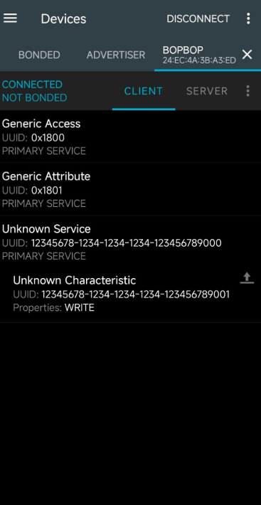
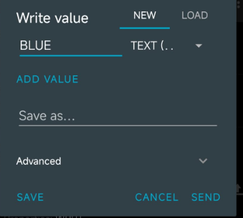
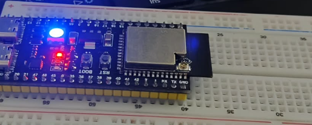

# BÀI THỰC HÀNH 5 — ĐIỀU KHIỂN LED QUA BLUETOOTH

**Sinh viên:** Trịnh Văn Quynh  
**Biến thể thực hiện:** ESP32 Bluetooth Low Energy (BLE) và ứng dụng điện thoại.  
**Nội dung có ảnh:** Kết nối thiết bị BLE, truy cập characteristic có thuộc tính WRITE, nhập lệnh BLUE và quan sát LED trên board.

> Tài liệu dùng 3 ảnh thực hành do sinh viên cung cấp. Bộ ảnh thể hiện cách làm BLE GATT trên ESP32, khác với HC-05/HC-06 dùng Bluetooth Classic SPP trong đề mẫu. Không coi hai phương thức là cùng giao thức hoặc đã hoàn thành đầy đủ các mục HC-05, COM ảo và WebApp chỉ từ các ảnh BLE này.

## 1. Mục tiêu

- Kết nối điện thoại với thiết bị ESP32 qua BLE.
- Nhận biết GATT service, characteristic và UUID.
- Ghi một chuỗi lệnh vào characteristic hỗ trợ WRITE.
- Quan sát LED và đối chiếu với lệnh điều khiển.
- Phân biệt trạng thái kết nối, bonding và kết quả xử lý lệnh.

## 2. Thiết bị và phần mềm

| Thành phần | Thông tin từ ảnh |
|---|---|
| Board | Board phát triển ESP32, đặt trên breadboard |
| Phần cứng hiển thị | Có đèn phát sáng màu xanh và đèn chỉ thị màu đỏ |
| Điện thoại | Có giao diện ứng dụng BLE, phù hợp cách thao tác nRF Connect |
| Tên thiết bị trên ứng dụng | BOPBOP |
| Địa chỉ BLE hiển thị | `24:EC:4A:3B:A3:ED` |
| Lệnh nhập | `BLUE` |

Ảnh chưa xác định đầy đủ mã module, chân điều khiển LED hoặc loại LED RGB. Không lấy tên board trong một bài khác hoặc mặc định GPIO2/GPIO48 để điền vào báo cáo này.

## 3. Nguyên lý điều khiển

Quy trình ứng dụng của bài:

1. ESP32 chạy chương trình BLE và cung cấp một GATT service.
2. Điện thoại kết nối, khám phá service và characteristic của ESP32.
3. Người dùng ghi chuỗi `BLUE` vào characteristic có quyền ghi phù hợp.
4. Chương trình trên ESP32 nhận giá trị, phân tích lệnh và điều khiển LED theo logic đã cài.

Trong luồng này, điện thoại đóng vai trò **GATT client**, ESP32 là **GATT server**. Tên thiết bị giúp người dùng nhận diện khi kết nối; UUID xác định service và characteristic cần truy cập.

Chưa có file firmware hoặc log Serial kèm theo, nên phần xử lý lệnh trong chương trình không được chép như thể đã đọc source thật của lần thực hành.

## 4. Các bước thực hiện

### 4.1. Chuẩn bị board và chương trình BLE

Để thực hiện lại:

1. Kiểm tra đúng board ESP32 và cổng nạp trong môi trường lập trình.
2. Nạp chương trình BLE có tên thiết bị, service UUID và characteristic UUID khớp với bài thử.
3. Characteristic cần hỗ trợ thao tác ghi mà client sử dụng.
4. Cấp nguồn board, bật Bluetooth điện thoại và quyền ứng dụng theo yêu cầu hệ điều hành.
5. Nếu có log Serial, mở log để quan sát kết nối và dữ liệu nhận.

Ảnh hiện có không thể hiện bước biên dịch hoặc upload. Vì vậy, phần này là hướng dẫn chuẩn bị để dựng lại, không phải nhật ký nạp đã được chứng minh bằng ảnh.

### 4.2. Kết nối và xem các service

1. Trong ứng dụng BLE, quét thiết bị xung quanh.
2. Chọn thiết bị có tên **BOPBOP** và đối chiếu địa chỉ hiển thị.
3. Kết nối rồi mở tab **CLIENT**.
4. Mở custom service để xem characteristic điều khiển.



*Hình 1. Ứng dụng hiển thị CONNECTED, NOT BONDED; service và characteristic tùy chỉnh có UUID được liệt kê.*

| Thành phần | Giá trị nhìn thấy |
|---|---|
| Trạng thái liên kết | CONNECTED |
| Trạng thái bonding | NOT BONDED |
| Generic Access | UUID `0x1800` |
| Generic Attribute | UUID `0x1801` |
| Custom service | `12345678-1234-1234-1234-123456789000` |
| Custom characteristic | `12345678-1234-1234-1234-123456789001` |
| Thuộc tính characteristic | WRITE |

**Nhận xét:** ảnh xác nhận điện thoại đã kết nối và hiển thị characteristic có khả năng ghi. Dòng Unknown Service/Unknown Characteristic thể hiện ứng dụng không có tên mô tả cho UUID tùy chỉnh; không tự đồng nghĩa với lỗi kết nối.

NOT BONDED không mâu thuẫn với CONNECTED. Bonding là việc lưu thông tin bảo mật để dùng lại trong các lần kết nối; một liên kết BLE có thể đang kết nối mà chưa có bonding. Việc truy cập có yêu cầu mã hóa/xác thực hay không còn phụ thuộc cấu hình bảo mật của server.

### 4.3. Nhập và gửi lệnh BLUE

1. Tại characteristic kết thúc bằng `9001`, chọn biểu tượng ghi giá trị.
2. Chọn dạng nhập **TEXT** như trong ảnh.
3. Nhập chính xác:

```text
BLUE
```

4. Nhấn **SEND** để gửi yêu cầu ghi.
5. Quan sát log hoặc phản hồi của ứng dụng và LED trên board.



*Hình 2. Hộp Write value có chuỗi BLUE, chế độ TEXT và nút SEND.*

**Lưu ý thao tác:** BLUE là bốn ký tự chữ hoa. Nếu nhập dạng hex thì bốn byte tương ứng là `42 4C 55 45`; không nhập chữ BLUE vào ô đang yêu cầu một chuỗi số hex. Có cần thêm ký tự xuống dòng hay không phải theo firmware thực tế, không tự thêm nếu chương trình chỉ so sánh chuỗi BLUE.

Ảnh Hình 2 ghi nhận nội dung chuẩn bị gửi; vì cửa sổ vẫn đang mở, riêng ảnh này chưa chứng minh thao tác SEND đã hoàn tất hoặc ESP32 đã thực thi lệnh. Log nhận lệnh sẽ giúp đối chiếu rõ hơn.

### 4.4. Quan sát LED trên phần cứng



*Hình 3. Board ESP32 được cấp nguồn và có đèn phát sáng màu xanh ở vùng LED trên board.*

**Nhận xét:** ảnh thể hiện trạng thái LED xanh, phù hợp với mục tiêu của lệnh BLUE trong bài thử. Tuy nhiên, ảnh tĩnh không ghi lại toàn bộ trình tự gửi lệnh → nhận lệnh → đổi màu. Để xác nhận quan hệ này đầy đủ, nên chụp log nhận BLUE hoặc quay một đoạn ngắn gồm thao tác SEND và LED đổi trạng thái.

Đèn đỏ trong ảnh không được mặc định là một kênh màu của cùng LED RGB; nó có thể là đèn chỉ thị riêng của board. Cần sơ đồ board hoặc code chân điều khiển để xác định.

## 5. Bảng tổng hợp kết quả

| Hạng mục | Minh chứng | Kết luận |
|---|---|---|
| Kết nối BLE | Hình 1 | Thiết bị hiển thị CONNECTED |
| Khám phá service | Hình 1 | Có custom service UUID kết thúc `9000` |
| Characteristic điều khiển | Hình 1 | Có characteristic UUID kết thúc `9001`, Properties: WRITE |
| Chuẩn bị lệnh | Hình 2 | Đã nhập BLUE ở chế độ TEXT |
| Trạng thái LED | Hình 3 | Có đèn phát sáng màu xanh |
| Log ESP32 nhận lệnh | Chưa cung cấp | Chưa xác nhận bằng log |
| Thời gian đáp ứng / khoảng cách | Chưa cung cấp | Không điền số đo suy đoán |
| Các lệnh màu khác hoặc tắt LED | Chưa cung cấp | Chưa kết luận đã thử |

## 6. Giải thích và trả lời

### 6.1. Service và characteristic khác nhau như thế nào?

Service nhóm các chức năng liên quan. Characteristic chứa giá trị và thông tin truy cập cho một chức năng cụ thể. Trong ảnh, service `...9000` chứa characteristic `...9001` hỗ trợ ghi.

### 6.2. UUID dùng để làm gì?

UUID nhận diện service/characteristic. Client cần chọn đúng UUID mà firmware cung cấp để ghi dữ liệu tới đúng chức năng. UUID và địa chỉ BLE là hai loại thông tin khác nhau, không dùng thay nhau.

### 6.3. WRITE nghĩa là gì?

Thuộc tính WRITE cho biết characteristic có hỗ trợ thao tác ghi. Client thực hiện ghi giá trị, còn firmware quyết định cách xử lý giá trị đó. Ghi thành công ở tầng giao tiếp không tự chứng minh tải hoặc LED vật lý đã đạt trạng thái mong muốn.

### 6.4. NOT BONDED có phải chưa kết nối không?

Không. Trong ảnh, thiết bị vừa CONNECTED vừa NOT BONDED. Đây là hai trạng thái khác nhau: kết nối hiện tại và việc lưu thông tin bảo mật cho lần sau. Không kết luận đường truyền đã mã hóa chỉ từ chữ CONNECTED.

### 6.5. BLE trên ESP32 có giống HC-05 không?

Không. Bài thử hiện tại ghi characteristic qua BLE GATT. HC-05/HC-06 thông thường sử dụng Bluetooth Classic SPP để trao đổi dữ liệu nối tiếp. Luồng thao tác, API và công cụ kết nối khác nhau. Không dùng các ảnh BLE này làm bằng chứng đã cấu hình AT cho HC-05 hoặc đã chạy COM ảo trong Proteus.

### 6.6. Vì sao LED có thể không đổi dù điện thoại kết nối được?

Các nguyên nhân cần kiểm tra gồm:

- Ghi sai characteristic hoặc chỉ nhập nhưng chưa SEND.
- Định dạng TEXT/HEX không đúng với dữ liệu mong đợi.
- Firmware phân biệt chữ hoa/chữ thường hoặc có quy tắc kết thúc lệnh khác.
- Đúng lệnh nhưng sai chân, sai loại LED hoặc thư viện điều khiển LED.
- Board dùng LED địa chỉ nhưng chương trình điều khiển như GPIO LED thông thường.

Chưa có code/log nên không chọn một nguyên nhân làm kết luận cho lần thử này.

## 7. Đối chiếu với các mục của đề TH5

| Mục đề mẫu | Phạm vi ảnh hiện có |
|---|---|
| 5.1 — HC-05 và lệnh AT | Chưa có ảnh AT; bài thử BLE là biến thể khác |
| 5.2 — Mô phỏng HC-05/HC-06 trong Proteus qua COM | Chưa có ảnh mô phỏng hoặc cấu hình COM |
| 5.3 — Điều khiển LED qua Bluetooth và WebApp | Có phần điều khiển LED theo cách BLE bằng điện thoại; chưa có WebApp/Node.js/Serial |
| 5.4 — DHT11 và biểu đồ thời gian thực | Chưa có ảnh cảm biến, dữ liệu hoặc biểu đồ |

Nếu giảng viên cho phép thay phương thức truyền, có thể trình bày bộ ảnh này dưới tiêu đề **“Bài 5 — Biến thể điều khiển LED qua BLE GATT trên ESP32”**. Không tự coi biến thể đã thay thế toàn bộ các yêu cầu còn lại khi chưa đối chiếu yêu cầu chấm bài.

## 8. Minh chứng có thể bổ sung

1. Code BLE khớp tên thiết bị và hai UUID trong Hình 1.
2. Log Serial hiển thị kết nối và nhận BLUE.
3. Ảnh/video trước và sau khi nhấn SEND.
4. Nếu firmware hỗ trợ, thử thêm lệnh tắt hoặc màu khác và ghi đúng kết quả.
5. Ảnh tên board, model LED hoặc sơ đồ chân để giải thích cách điều khiển phần cứng.

## 9. Kết luận

Bộ ảnh ghi nhận điện thoại kết nối với thiết bị BLE BOPBOP, khám phá characteristic hỗ trợ WRITE, nhập lệnh BLUE và quan sát LED xanh trên ESP32. Đây là minh chứng cho bài thử BLE GATT ở các bước được chụp; cần log hoặc ghi hình liên tục để xác nhận đầy đủ trình tự xử lý lệnh. Chưa có minh chứng cho HC-05, mô phỏng COM, WebApp hoặc bài cảm biến DHT11 trong lần gửi ảnh này.

---

**Nguồn ảnh:** 3 ảnh thực hành do sinh viên cung cấp ngày 18/10/2026.  
**Tham khảo kỹ thuật:** [Espressif — GATT Server Walkthrough](https://github.com/espressif/esp-idf/blob/master/examples/bluetooth/bluedroid/ble/gatt_server/tutorial/Gatt_Server_Example_Walkthrough.md).  
**Đưa lên GitHub:** giữ `BTH05.md` và thư mục `images` cạnh nhau để ảnh hiển thị đúng.
