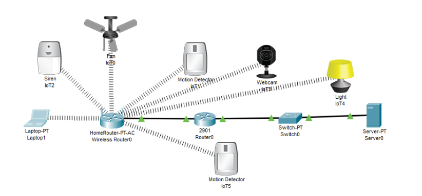
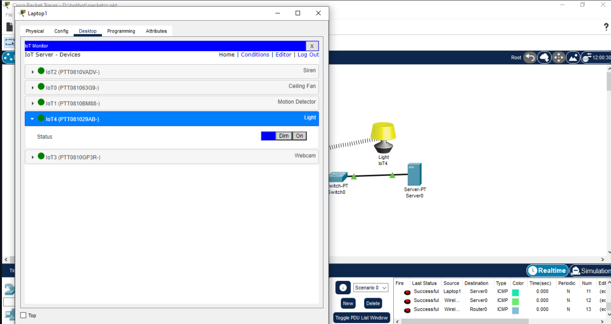
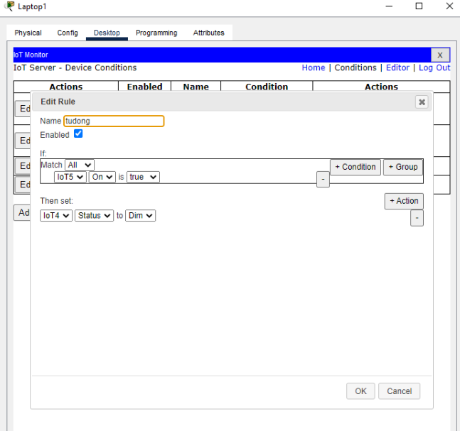
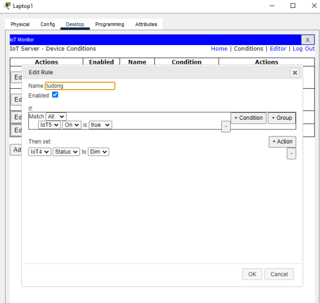
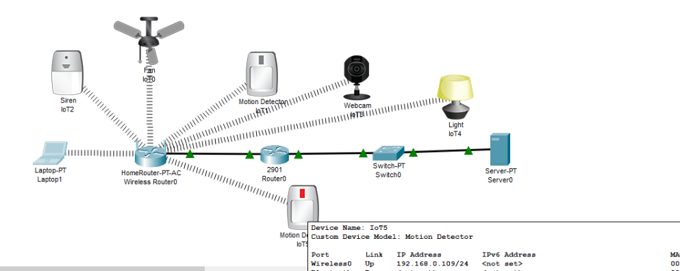
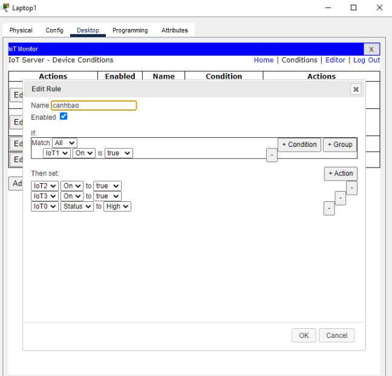
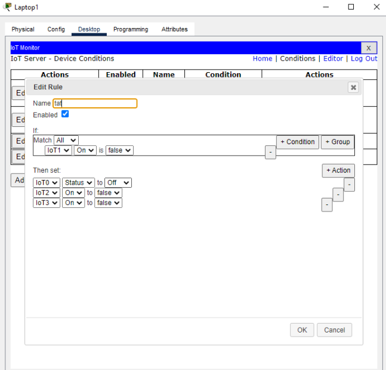

# BÀI THỰC HÀNH 4 — MẠNG ETHERNET VÀ TCP/IP TRONG IoT

**Sinh viên:** Trịnh Văn Quynh  
**Phần mềm:** Cisco Packet Tracer  
**Nội dung:** Điều khiển thiết bị từ IoT Server, thiết lập chiếu sáng tự động và cảnh báo khi phát hiện chuyển động.

> Báo cáo sử dụng 8 ảnh chụp mô phỏng do sinh viên cung cấp. Phần nhận xét phân biệt trạng thái nhìn thấy trong ảnh với kết quả cần kiểm tra thêm. Các địa chỉ IP không xuất hiện trong ảnh được để bổ sung từ project thực tế.

## 1. Mục tiêu

- Nhận biết mô hình kết nối thiết bị IoT với mạng gia đình và máy chủ.
- Giám sát, điều khiển thiết bị qua giao diện IoT Monitor.
- Tạo điều kiện và hành động tự động trên IoT Server.
- Kết hợp cảm biến chuyển động, đèn, còi, camera và quạt trong một hệ thống mô phỏng.

## 2. Mô hình và thiết bị sử dụng

*Hình 1. Mô hình gồm Laptop1, Wireless Router0, Router0, Switch0, Server0 và các thiết bị IoT.*

Theo sơ đồ, các thiết bị IoT và laptop có liên kết không dây tới HomeRouter-PT-AC. Router gia đình kết nối tới router 2901, sau đó tới switch và server bằng các đường nối có dây. Các liên kết có dây trong ảnh hiển thị chỉ thị màu xanh.

| Thiết bị trong ảnh | Loại thiết bị | Vai trò trong bài |
|---|---|---|
| Laptop1 | Laptop-PT | Truy cập IoT Monitor để điều khiển và cấu hình điều kiện |
| Wireless Router0 | HomeRouter-PT-AC | Kết nối không dây cho laptop và thiết bị IoT |
| Router0 | Cisco 2901 | Kết nối các phần mạng trong mô hình |
| Switch0 | Switch-PT | Kết nối router với máy chủ |
| Server0 | Server-PT | Máy chủ đăng ký và quản lý thiết bị IoT |
| IoT0 | Fan / Ceiling Fan | Quạt có các mức trạng thái, được dùng thêm trong rule cảnh báo |
| IoT1 | Motion Detector | Cảm biến kích hoạt rule cảnh báo |
| IoT2 | Siren | Còi cảnh báo |
| IoT3 | Webcam | Camera mô phỏng |
| IoT4 | Light | Đèn điều khiển thủ công và tự động |
| IoT5 | Motion Detector | Cảm biến kích hoạt rule chiếu sáng |

### Thông tin cấu hình có thể xác nhận

Trong ảnh kiểm tra ở cuối phần 4.2, cửa sổ thông tin của **IoT5** hiển thị cổng **Wireless0**, trạng thái liên kết **Up** và địa chỉ **192.168.0.109/24**. Chưa có ảnh thể hiện IP của router, server, gateway, SSID hoặc thông tin tài khoản, nên không điền các thông số đó bằng giá trị ví dụ của tài liệu khác.

| Thông số | Giá trị ghi nhận |
|---|---|
| IP IoT5 | `192.168.0.109/24` |
| Liên kết Wireless0 của IoT5 | `Up` |
| IP Server0 | Chưa hiển thị trong ảnh được cung cấp |
| IP các cổng Router0 | Chưa hiển thị trong ảnh được cung cấp |
| SSID và gateway thực tế | Cần đối chiếu trong project Packet Tracer |

## 3. Bài 4.1 — Điều khiển thiết bị IoT từ máy chủ

### 3.1. Chuẩn bị kết nối và đăng ký

Trình tự thực hiện để dựng lại hệ thống:

1. Bố trí thiết bị và kết nối theo sơ đồ ở Hình 1.
2. Cấu hình địa chỉ IP, subnet mask và gateway phù hợp cho từng mạng con trong project.
3. Bật dịch vụ IoT trên Server0.
4. Cho laptop và các thiết bị IoT kết nối đúng mạng không dây.
5. Đăng ký thiết bị với cùng máy chủ và tài khoản quản lý.
6. Trên Laptop1, mở **Desktop → IoT Monitor**, kết nối tới máy chủ đã cấu hình.
7. Kiểm tra danh sách thiết bị trước khi gửi lệnh điều khiển.

Hai ảnh dưới đây thể hiện giao diện quản lý đã có các thiết bị và khả năng chuyển trạng thái của đèn. Chúng không thể hiện toàn bộ thao tác đặt IP hoặc đăng ký tài khoản ở các bước chuẩn bị.

### 3.2. Điều khiển đèn sang Off

1. Tại trang **IoT Server - Devices**, chọn thiết bị **IoT4 — Light**.
2. Nhấn mũi tên để mở phần chi tiết của thiết bị.
3. Tại dòng **Status**, chọn **Off**.
4. Quan sát lựa chọn trên giao diện và biểu tượng đèn trong mô hình.

*Hình 2. Thiết bị IoT4 được mở rộng và lựa chọn Off được tô xanh.*

**Nhận xét:** ảnh ghi nhận thao tác điều khiển đèn về trạng thái Off. Danh sách quản lý đồng thời có Siren, Ceiling Fan, Motion Detector, Light và Webcam. Các dấu tròn màu xanh cạnh thiết bị là chỉ báo trên giao diện quản lý; không dùng chúng để kết luận mọi cơ chế tự động đều đã được kiểm thử.

### 3.3. Điều khiển đèn sang On

1. Giữ cửa sổ quản lý của **IoT4** đang mở.
2. Chọn **On** tại dòng **Status**.
3. So sánh trạng thái với Hình 2.

*Hình 3. Lựa chọn On được tô xanh; biểu tượng đèn xuất hiện sáng hơn so với ảnh Off.*

**Nhận xét:** cặp ảnh Off/On cho thấy có thể thay đổi trạng thái đèn từ giao diện quản lý thiết bị. Ở phần danh sách PDU bên dưới cửa sổ, có các dòng ICMP mang trạng thái **Successful**, trong đó thấy Laptop1 gửi tới Server0 và Wireless Router0. Do không có cửa sổ nội dung từng gói, không suy ra địa chỉ IP hoặc tỷ lệ mất gói cụ thể từ các dòng này.

### 3.4. Tổng hợp kết quả bài 4.1

| Nội dung kiểm tra | Bằng chứng trong ảnh | Nhận xét |
|---|---|---|
| Hiển thị thiết bị trên IoT Monitor | Hình 2, Hình 3 | Có danh sách các thiết bị được quản lý |
| Điều khiển Off | Hình 2 | Off được chọn cho IoT4 |
| Điều khiển On | Hình 3 | On được chọn và biểu tượng đèn thay đổi |
| Kiểm tra ICMP | Danh sách PDU ở Hình 2, Hình 3 | Có dòng Successful; chưa có chi tiết đầy đủ từng phép thử |

## 4. Bài 4.2 — Thiết lập chiếu sáng tự động

### 4.1. Ý tưởng điều khiển

Cảm biến **IoT5** cung cấp trạng thái làm điều kiện. Khi thuộc tính **On** của IoT5 là **true**, máy chủ yêu cầu đèn **IoT4** chuyển sang **Dim**.

> **Đúng với ảnh hiện có:** action đang là **Dim** — mức sáng giảm, không phải **On**. Nếu đề yêu cầu bật sáng ở mức On, đổi giá trị action từ Dim sang On rồi chụp lại cấu hình và kết quả.

### 4.2. Tạo điều kiện `tudong`

1. Trên IoT Monitor, mở mục **Conditions**.
2. Thêm rule mới hoặc chọn chỉnh sửa rule hiện có.
3. Đặt **Name = tudong**.
4. Đánh dấu **Enabled** để bật rule.
5. Phần **If** chọn:
   - Thiết bị: **IoT5**.
   - Thuộc tính: **On**.
   - Giá trị so sánh: **true**.
6. Phần **Then set** chọn:
   - Thiết bị: **IoT4**.
   - Thuộc tính: **Status**.
   - Giá trị: **Dim**.
7. Nhấn **OK** để lưu và kiểm tra lại rule trong danh sách.

*Hình 4. Rule tudong: If IoT5.On is true → Then set IoT4.Status to Dim.*

Ảnh tiếp theo cũng thể hiện cùng tên rule, điều kiện và hành động:

*Hình 5. Góc chụp bổ sung của rule tudong. Đây không phải một rule khác hoặc bằng chứng cho hành động Off khi cảm biến không kích hoạt.*

### 4.3. Kiểm tra trạng thái mô hình

Để kiểm chứng đầy đủ, nên thực hiện theo trình tự:

1. Đặt đèn về Off bằng điều khiển thủ công.
2. Xác nhận rule `tudong` đã lưu và Enabled.
3. Kích hoạt cảm biến IoT5 bằng thao tác tương tác mà model Packet Tracer hỗ trợ.
4. Quan sát trạng thái cảm biến và kiểm tra lại **IoT4 → Status** trong IoT Monitor.
5. Ghi đèn có tự chuyển sang Dim mà không bấm nút điều khiển tay hay không.

*Hình 6. IoT5 có chỉ thị màu đỏ; đèn xuất hiện sáng hơn so với Hình 1. Cửa sổ thông tin IoT5 hiển thị Wireless0 Up và IP 192.168.0.109/24.*

**Nhận xét:** ảnh cấu hình và ảnh mô hình phù hợp với kịch bản điều khiển chiếu sáng theo cảm biến. Tuy nhiên, riêng ảnh tĩnh không thể hiện toàn bộ chuỗi thao tác hoặc loại trừ việc đèn được điều khiển tay; cần đối chiếu trạng thái IoT Monitor khi thực hiện lại. Chưa có ảnh rule `IoT5.On = false` để tắt đèn, vì vậy chưa kết luận hệ thống đã tự tắt khi hết chuyển động.

### 4.4. Logic đã cấu hình

| Điều kiện | Hành động trong ảnh | Phần cần đối chiếu thêm |
|---|---|---|
| `IoT5.On = true` | `IoT4.Status = Dim` | Kiểm tra Status của đèn khi cảm biến kích hoạt |
| `IoT5.On = false` | Chưa có rule tương ứng trong ảnh | Nếu muốn tự tắt, cần bổ sung rule phù hợp |

## 5. Bài 4.3 — Phát hiện chuyển động và cảnh báo

### 5.1. Rule cảnh báo `canhbao`

Kịch bản sử dụng **IoT1** làm cảm biến kích hoạt. Khi cảm biến có thuộc tính **On = true**, máy chủ đồng thời bật còi, bật camera và đặt quạt ở mức High.

Trình tự cấu hình:

1. Vào **Conditions** và tạo rule tên **canhbao**.
2. Đánh dấu **Enabled**.
3. Phần **If** chọn **IoT1 → On → is true**.
4. Dùng **+ Action** để thêm ba hành động:
   - **IoT2 → On → true**: bật còi.
   - **IoT3 → On → true**: bật Webcam.
   - **IoT0 → Status → High**: đặt quạt ở mức High.
5. Nhấn **OK** để lưu.

*Hình 7. Rule canhbao liên kết trạng thái IoT1 với còi IoT2, Webcam IoT3 và quạt IoT0.*

**Nhận xét:** còi và camera đáp ứng hai đầu ra của kịch bản cảnh báo; hành động điều khiển quạt là phần bổ sung trong mô hình của sinh viên. Ảnh này thể hiện cửa sổ cấu hình, chưa chứng minh rule đã được lưu hoặc các đầu ra đã chạy trong lần thử thực tế.

### 5.2. Rule khôi phục `tat`

Khi thuộc tính **On** của cảm biến **IoT1** là **false**, rule thứ hai đưa các đầu ra về trạng thái tắt.

1. Thêm rule tên **tat** và đánh dấu **Enabled**.
2. Phần **If** chọn **IoT1 → On → is false**.
3. Cấu hình các action:
   - **IoT0 → Status → Off**.
   - **IoT2 → On → false**.
   - **IoT3 → On → false**.
4. Nhấn **OK** để lưu.

*Hình 8. Rule tat: khi IoT1.On = false, quạt Off, còi và Webcam được đặt On = false.*

### 5.3. Bảng logic của hệ thống cảnh báo

| Trạng thái cảm biến | Còi IoT2 | Webcam IoT3 | Quạt IoT0 |
|---|---|---|---|
| `IoT1.On = true` | `On = true` | `On = true` | `Status = High` |
| `IoT1.On = false` | `On = false` | `On = false` | `Status = Off` |

Đây là **bảng hành động theo cấu hình trong ảnh**, không phải bảng đo trạng thái đầu ra đã được xác nhận.

### 5.4. Kiểm tra cần thực hiện thêm

1. Xác nhận cả `canhbao` và `tat` có mặt trong danh sách rule và đang Enabled.
2. Cho IoT1 chuyển sang true; quan sát riêng trạng thái còi, Webcam và quạt.
3. Cho IoT1 trở về false; kiểm tra cả ba đầu ra trở về trạng thái theo bảng.
4. Chụp ảnh IoT Monitor mở rộng các thiết bị tại hai trạng thái hoặc quay ngắn toàn bộ chu kỳ.
5. Ghi nhận nếu có rule khác cùng điều khiển một đầu ra và gây xung đột.

Không khẳng định Webcam đã ghi tệp video: ảnh hiện có chỉ thiết lập thuộc tính **On** của thiết bị mô phỏng.

## 6. Giải thích và nhận xét

### 6.1. Vai trò của máy chủ IoT

Trong mô hình, máy chủ cung cấp giao diện quản lý thiết bị và điều kiện tự động. Laptop được dùng để truy cập giao diện, gửi yêu cầu điều khiển hoặc tạo rule. Cảm biến cung cấp trạng thái để các rule lựa chọn hành động tương ứng.

### 6.2. Điều khiển thủ công và tự động khác nhau thế nào?

- **Thủ công:** người dùng chọn trực tiếp Off/Dim/On trên giao diện đèn.
- **Tự động:** trạng thái thiết bị được đặt thông qua điều kiện của cảm biến trong rule đã bật.

Cùng một biểu tượng đèn sáng chưa đủ phân biệt hai trường hợp. Cần kiểm tra trạng thái cảm biến, rule và chuỗi thao tác thử nghiệm.

### 6.3. Vì sao cần rule khôi phục?

Rule cảnh báo chỉ quy định hành động khi điều kiện đúng. Nếu muốn các đầu ra tắt sau khi cảm biến trở về false, cần cấu hình hành động khôi phục rõ ràng như rule `tat`. Không suy ra máy chủ tự đảo tất cả hành động của rule thứ nhất.

### 6.4. Vì sao cần hai cảm biến khác nhau?

Ảnh hiện có dùng **IoT5** cho đèn và **IoT1** cho nhóm cảnh báo. Khi thao tác hoặc chỉnh rule cần chọn đúng tên thiết bị, tránh kích hoạt một cảm biến nhưng chờ đầu ra thuộc cảm biến còn lại.

## 7. Tổng kết mức độ minh chứng

| Mục | Nội dung đã thể hiện trong ảnh | Nội dung cần bổ sung nếu yêu cầu báo cáo đầy đủ |
|---|---|---|
| 4.1 | Danh sách IoT, lựa chọn đèn Off/On, một số dòng PDU Successful | IP các cổng, cấu hình Wi-Fi, đăng ký server và chi tiết kiểm tra kết nối |
| 4.2 | Rule IoT5 → IoT4 Dim và ảnh mô hình ở trạng thái khác | Danh sách rule sau lưu, Status của đèn khi tự động, rule tắt nếu cần |
| 4.3 | Hai cửa sổ cấu hình canhbao và tat | Ảnh các đầu ra khi IoT1 true/false và xác nhận lưu rule |

## 8. Kết luận

Qua các ảnh cung cấp, hệ thống đã thể hiện khả năng quản lý thiết bị và điều khiển đèn thủ công trên IoT Monitor. Các cửa sổ cấu hình mô tả được logic chiếu sáng theo IoT5 và logic cảnh báo/khôi phục theo IoT1. Để kết luận đầy đủ về hoạt động tự động, cần thực hiện lại chu kỳ kích hoạt và chụp trạng thái các đầu ra sau khi lưu rule.

---

**Nguồn ảnh:** 8 ảnh chụp Cisco Packet Tracer do sinh viên cung cấp ngày 18/10/2026.  
**Cách dùng trên GitHub:** giữ `BTH04.md` và thư mục `images` cạnh nhau; các đường dẫn ảnh trong file là đường dẫn tương đối.
