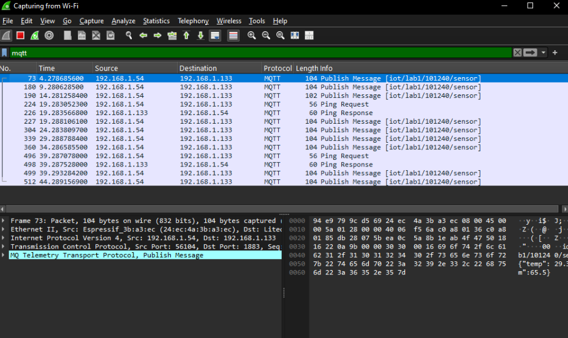
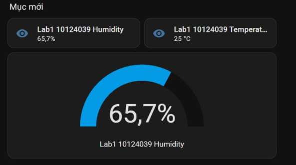

# BÀI THỰC HÀNH 12 — GIAO THỨC MQTT

**Sinh viên:** Trịnh Văn Quynh  
**Nội dung có ảnh minh chứng:** Bài 12.1 — Truyền dữ liệu MQTT và hiển thị trên Home Assistant.  
**Công cụ xuất hiện trong ảnh:** Wireshark, Home Assistant.

> Tài liệu sử dụng hai ảnh chụp do sinh viên cung cấp. Các thông tin đọc được được ghi riêng với hướng dẫn thực hiện lại. Chưa có ảnh minh chứng điều khiển LED ở bài 12.2 hoặc kiểm thử Retain/LWT ở bài 12.3.

## 1. Mục tiêu

- Hiểu vai trò MQTT client, broker và subscriber.
- Quan sát bản tin PUBLISH, PINGREQ và PINGRESP.
- Xác định địa chỉ IP, cổng TCP và topic từ ảnh Wireshark.
- Hiển thị nhiệt độ, độ ẩm dưới dạng entity trên Home Assistant.
- Phân biệt ảnh dữ liệu hiển thị với bằng chứng về nguồn dữ liệu và cơ chế truyền.

## 2. Nguyên lý hệ thống

Luồng truyền dữ liệu dự kiến của bài thực hành:

1. Thiết bị ESP hoặc chương trình phát dữ liệu tạo bản tin có nhiệt độ và độ ẩm.
2. MQTT client trên thiết bị gửi PUBLISH lên broker, kèm topic và payload.
3. Home Assistant đăng ký nhận topic phù hợp.
4. Home Assistant trích trường dữ liệu để cập nhật các entity và thẻ dashboard.

Hai ảnh hiện có chưa cho biết model ESP, loại cảm biến, code tạo dữ liệu hoặc cấu hình broker. Vì vậy, không xác định dữ liệu là số đo từ DHT hay dữ liệu giả lập chỉ dựa vào các ảnh này.

## 3. Bài 12.1 — Truyền dữ liệu và phân tích gói tin

### 3.1. Chuẩn bị hệ thống

Để thực hiện lại, cần có:

- Thiết bị ESP chạy chương trình MQTT, hoặc chương trình client phù hợp.
- Broker MQTT đang hoạt động và có cấu hình truy cập đúng.
- Home Assistant đã kết nối broker.
- Wireshark tại vị trí quan sát được lưu lượng của client/broker.

Kiểm tra IP, port, tài khoản broker, topic và cấu trúc payload trước khi thử. Không lấy tên thẻ dashboard làm bằng chứng duy nhất về topic mà entity đang subscribe.

### 3.2. Gửi bản tin dữ liệu

1. Cho MQTT client kết nối tới broker.
2. Cấu hình client gửi dữ liệu lên đúng topic.
3. Payload cần có các trường mà Home Assistant được cấu hình để đọc, ví dụ `temp` và `hum`.
4. Kiểm tra việc gửi lặp lại theo chu kỳ của chương trình.

**Ví dụ cấu trúc payload, không phải bản chép số liệu từ ảnh:**

```json
{"temp": 25.0, "hum": 65.7}
```

Các số trong ví dụ chỉ minh họa định dạng JSON. Không coi đây là payload của frame đang được chọn trong ảnh Wireshark.

### 3.3. Bắt và lọc MQTT trên Wireshark

1. Mở Wireshark, chọn giao diện quan sát được lưu lượng. Ảnh được cung cấp hiển thị phiên **Capturing from Wi-Fi**.
2. Nhập bộ lọc hiển thị:

```wireshark
mqtt
```

3. Nhấn Enter để áp dụng.
4. Cho thiết bị gửi dữ liệu, quan sát các dòng **Publish Message**.
5. Chọn một gói và mở các tầng Ethernet II, IPv4, TCP và MQTT để phân tích.



*Hình 1. Wireshark đang lọc mqtt; frame 73 được chọn. Danh sách có Publish Message, Ping Request và Ping Response.*

> Chọn card Wi-Fi không tự bảo đảm thấy mọi unicast giữa hai thiết bị khác trong LAN. Với lần thực hiện lại, cần chọn đúng điểm capture. Ảnh này đã hiển thị được luồng MQTT cần phân tích.

### 3.4. Thông tin đọc được từ ảnh

| Trường | Giá trị quan sát được | Ý nghĩa |
|---|---|---|
| Frame đang chọn | `73` | Số thứ tự gói trong phiên capture |
| Thời gian của frame 73 | Khoảng `4,2787 s` trong cột Time | Mốc thời gian Wireshark hiển thị; không phải giờ đồng hồ thực |
| Độ dài frame 73 | `104 bytes` | Tổng kích thước frame được Wireshark ghi nhận, không phải riêng payload MQTT |
| IP nguồn | `192.168.1.54` | Bên gửi PUBLISH trong frame được chọn |
| IP đích | `192.168.1.133` | Bên nhận PUBLISH |
| Cổng TCP nguồn | `56104` | Cổng của kết nối phía client trong frame này |
| Cổng TCP đích | `1883` | Cổng nhận MQTT plaintext trong luồng đang xét |
| MAC nguồn | `24:ec:4a:3b:a3:ec` | Được Wireshark gắn nhãn Espressif trong phần Ethernet II |
| Topic | `iot/lab1/101240/sensor` | Topic xuất hiện tại cột Info |
| Loại bản tin được chọn | `Publish Message` | Bản tin mang dữ liệu ứng dụng |
| Các loại bản tin khác thấy trong danh sách | `Ping Request`, `Ping Response` | Trao đổi kiểm tra hoạt động MQTT |

**Nhận xét về vai trò:** hướng PUBLISH từ `192.168.1.54` tới `192.168.1.133:1883`, cùng các Ping Response theo chiều ngược lại, phù hợp với việc `.54` là MQTT client phát dữ liệu và `.133` là broker. Chưa có ảnh cấu hình dịch vụ để xác định broker được cài trực tiếp trên Home Assistant hay trên một máy khác.

### 3.5. Phân tích theo mô hình TCP/IP

#### Tầng liên kết — Ethernet II

Khung chi tiết hiển thị **Ethernet II**, có địa chỉ MAC nguồn và đích. MAC nguồn của frame được chọn đọc được là `24:ec:4a:3b:a3:ec`.

Tên và địa chỉ MAC đích bị giới hạn bởi phần hiển thị trong ảnh. Để điền đầy đủ, mở rộng mục Ethernet II và chụp lại toàn bộ các dòng Destination, Source, Type. Không suy ra MAC đích trực tiếp từ địa chỉ IP.

#### Tầng mạng — IPv4

Gói được chọn có IPv4 nguồn `192.168.1.54` và đích `192.168.1.133`. Đây là cặp endpoint của gói IP đang phân tích.

#### Tầng giao vận — TCP

Frame sử dụng TCP với source port `56104`, destination port `1883`. TCP cung cấp luồng byte có thứ tự, cơ chế xác nhận và gửi lại khi cần. Số thứ tự TCP/ACK không phải số frame trong cột No.

Ảnh chưa mở rộng đủ các dòng Sequence Number và Acknowledgment Number; cần bổ sung từ Packet Details nếu báo cáo yêu cầu số cụ thể.

#### Tầng ứng dụng — MQTT

Wireshark nhận diện frame là MQTT PUBLISH. Topic trong cột Info là `iot/lab1/101240/sensor`. Phần byte/ASCII cho thấy nội dung có tên trường `temp` và `hum`.

Để trích chính xác toàn bộ payload, QoS, DUP và Retain, mở rộng **MQ Telemetry Transport Protocol → Publish Message** và chụp rõ các trường. Không xác định QoS chỉ từ việc dùng cổng 1883 hoặc nhìn thấy chữ Publish Message.

### 3.6. Quan sát chu kỳ PUBLISH và Ping

Danh sách có nhiều PUBLISH ở các thời điểm xấp xỉ 4,28 s, 9,28 s, 14,28 s… Các mốc này gợi ý chương trình đang phát dữ liệu theo chu kỳ khoảng **5 giây**. Đây là nhận xét từ các gói nhìn thấy, không phải khẳng định chu kỳ luôn cố định trong toàn phiên.

Các dòng **Ping Request** và **Ping Response** xuất hiện trong danh sách. Khi phân tích chi tiết:

1. Chọn một Ping Request và ghi frame number, time, source, destination.
2. Chọn Ping Response tương ứng, đối chiếu chiều gửi ngược lại.
3. Dùng chênh lệch thời gian để đánh giá khoảng phản hồi.
4. Đọc gói CONNECT để biết giá trị Keep Alive đã thỏa thuận. Không lấy riêng khoảng cách giữa hai Ping để mặc định đó chính xác là Keep Alive.

## 4. Hiển thị dữ liệu trên Home Assistant

### 4.1. Cấu hình nhận dữ liệu

Quy trình thực hiện lại:

1. Kết nối MQTT integration tới broker đang sử dụng.
2. Xác định topic mà thiết bị thực tế publish.
3. Tạo sensor nhiệt độ đọc trường `temp`, sensor độ ẩm đọc trường `hum`.
4. Khai báo đơn vị tương ứng `°C` và `%`.
5. Kiểm tra entity trong Developer Tools → States.
6. Thêm thẻ hiển thị giá trị và thẻ Gauge cho độ ẩm lên dashboard.

Ảnh hiện có không chứa YAML hoặc cấu hình entity. Phải đối chiếu `state_topic` thực tế trước khi kết luận các thẻ đang đọc từ topic nào.

### 4.2. Kết quả dashboard



*Hình 2. Home Assistant hiển thị thẻ nhiệt độ, thẻ độ ẩm và đồng hồ Gauge độ ẩm.*

| Thành phần | Nội dung nhìn thấy |
|---|---|
| Thẻ độ ẩm | `Lab1 10124039 Humidity` |
| Giá trị độ ẩm | `65,7%` |
| Thẻ nhiệt độ | Tên bắt đầu bằng `Lab1 10124039 Temperat...` |
| Giá trị nhiệt độ | `25 °C` |
| Gauge | `65,7%`, nhãn `Lab1 10124039 Humidity` |

**Nhận xét:** thẻ độ ẩm và Gauge cùng hiển thị 65,7% tại thời điểm chụp; thẻ nhiệt độ hiển thị 25 °C. Ảnh chứng minh dashboard có các giá trị đang hiển thị, nhưng chưa chứng minh thời gian cập nhật, độ chính xác cảm biến hoặc việc dữ liệu tiếp tục thay đổi theo thời gian.

### 4.3. Đối chiếu topic với tên entity

Hai ảnh có một điểm cần kiểm tra:

- Wireshark hiển thị topic chứa mã **`101240`**.
- Dashboard có nhãn chứa mã **`10124039`**.

Tên hiển thị của entity có thể được đặt tùy ý, nên khác tên chưa đủ kết luận cấu hình sai. Tuy nhiên, hai ảnh cũng chưa đủ chứng minh frame 73 chính là mẫu dữ liệu đã tạo ra các giá trị trên dashboard.

Để xác nhận toàn bộ luồng:

1. Mở cấu hình sensor, kiểm tra `state_topic`.
2. Kiểm tra `value_template` đọc đúng `temp` và `hum`.
3. Gửi một mẫu dữ liệu dễ phân biệt lên topic đó.
4. Chụp gói PUBLISH và dashboard gần cùng thời điểm.
5. So sánh trực tiếp hai trường trong payload với giá trị các entity.

## 5. Trả lời câu hỏi bài 12.1

### 5.1. Thiết bị nào là client, thiết bị nào là broker?

Trong luồng được chụp, `192.168.1.54` phát PUBLISH tới `192.168.1.133:1883` và nhận Ping Response chiều ngược lại. Vì vậy có cơ sở xác định `.54` là client phát dữ liệu và `.133` là broker của kết nối này. Home Assistant là một client/subscriber trong mô hình dự kiến; IP của Home Assistant chưa được xác nhận bằng ảnh dashboard.

### 5.2. Cổng client và broker có giống nhau không?

Không. Frame được chọn có client source port `56104`, broker destination port `1883`. Cổng nguồn có thể đổi ở lần kết nối khác, trong khi cổng lắng nghe của broker được cấu hình cố định cho dịch vụ đó.

### 5.3. Những loại bản tin nào đã quan sát được?

| Loại bản tin | Vai trò | Có trong ảnh hiện tại? |
|---|---|---|
| CONNECT | Client yêu cầu thiết lập phiên MQTT | Chưa thấy trong phần danh sách được chụp |
| CONNACK | Broker phản hồi kết nối | Chưa thấy trong phần danh sách được chụp |
| PUBLISH | Truyền dữ liệu theo topic | Có |
| PINGREQ | Client kiểm tra hoạt động kết nối | Có, hiển thị Ping Request |
| PINGRESP | Broker phản hồi Ping | Có, hiển thị Ping Response |
| DISCONNECT | Client kết thúc phiên có chủ đích | Chưa thấy trong phần danh sách được chụp |

“Chưa thấy trong ảnh” không đồng nghĩa bản tin không tồn tại trong file capture. Có thể chúng nằm ngoài phần đang hiển thị hoặc quá trình bắt đầu sau khi kết nối đã được tạo.

### 5.4. Topic, QoS và payload là gì?

- **Topic:** đường định danh dùng để phân phối bản tin; frame đang chọn hiển thị `iot/lab1/101240/sensor`.
- **QoS:** mức đảm bảo phân phối bản tin MQTT; cần đọc trường cụ thể của gói, không suy ra từ cổng TCP.
- **Payload:** nội dung ứng dụng. Ảnh có các trường `temp` và `hum`; chưa trích toàn bộ giá trị từ ảnh nhỏ để tránh nhầm số liệu.

### 5.5. Ping dùng để làm gì? Nếu không có Ping thì sao?

PINGREQ/PINGRESP hỗ trợ kiểm tra kết nối còn hoạt động khi client cần duy trì phiên. Nếu client vẫn gửi những control packet khác trong thời hạn yêu cầu, không nhất thiết phải thấy Ping liên tục.

Với MQTT 3.1.1 và Keep Alive khác 0, broker phải ngắt kết nối khi không nhận control packet trong thời gian vượt 1,5 lần Keep Alive. Không nên kết luận “không có Ping là mất kết nối” nếu vẫn có PUBLISH hoặc bản tin hợp lệ khác. Cần kiểm tra phiên bản và gói CONNECT của lần thử.

### 5.6. Username/password và dữ liệu có được mã hóa không?

MQTT plaintext không tự mã hóa payload hoặc trường username/password khi các trường đó được gửi trong CONNECT. Ảnh đã thể hiện MQTT có thể giải mã trực tiếp và payload đọc được. Tuy nhiên, ảnh không có CONNECT nên chưa chứng minh tài khoản nào hoặc mật khẩu nào đã xuất hiện trong lần capture này.

Khi cần bảo mật đường truyền, dùng MQTT qua TLS và xác minh chứng chỉ/hostname phù hợp; đổi số cổng đơn thuần không tạo mã hóa. Có thể kết hợp tài khoản và quyền truy cập topic để kiểm soát client.

## 6. Bài 12.2 — Điều khiển hai chiều: phần cần bổ sung

Hai ảnh hiện tại chưa thể hiện command topic, state topic hoặc thiết bị LED. Để hoàn thiện mục này:

1. Cấu hình thiết bị subscribe topic lệnh và publish topic trạng thái riêng.
2. Gửi ON/OFF từ Home Assistant.
3. Chụp thiết bị trước/sau và trạng thái phản hồi trên dashboard.
4. Chụp PUBLISH lệnh và PUBLISH trạng thái ở Wireshark.
5. Ghi rõ payload, IP, topic và frame number của hai chiều.

Không sử dụng ảnh nhiệt độ/độ ẩm làm minh chứng rằng điều khiển LED đã thành công.

## 7. Bài 12.3 — Retain và bài toán nhớ/quên: phần cần bổ sung

Chưa có ảnh phép thử Retain hoặc LWT. Trình tự kiểm tra đề xuất:

1. Publish trạng thái có Retain, sau đó mở subscriber mới để xem có nhận ngay trạng thái cuối không.
2. Thử Retain=false sau khi đã xóa retained message cũ để kết quả không bị ảnh hưởng.
3. Khởi động lại Home Assistant và ghi nhận hiển thị.
4. Reset ESP, đối chiếu trạng thái vật lý với trạng thái hiển thị.
5. Nếu có LWT, thử mất kết nối bất thường và quan sát thời điểm broker phát offline.

Retain giữ giá trị mới nhất theo topic tại broker; nó không tự lưu trạng thái GPIO trong bộ nhớ ESP. Việc ESP nhớ đầu ra sau reset cần cơ chế khôi phục được cài trong firmware hoặc ứng dụng.

## 8. Tổng kết kết quả hiện có

| Nội dung | Minh chứng | Kết luận phù hợp |
|---|---|---|
| Phát dữ liệu MQTT | Hình 1 | Có các gói PUBLISH trên topic được ghi nhận |
| Trao đổi Ping | Hình 1 | Có Ping Request và Ping Response |
| Hiển thị nhiệt độ/độ ẩm | Hình 2 | Dashboard hiển thị 25 °C và 65,7% |
| Gói được chọn tạo ra đúng giá trị trên dashboard | Chưa đủ | Cần đối chiếu topic, template và thời điểm |
| Điều khiển LED hai chiều | Chưa có ảnh | Chưa kết luận cho bài 12.2 |
| Retain/LWT và hành vi sau reset | Chưa có ảnh | Chưa kết luận cho bài 12.3 |

## 9. Kết luận

Ảnh thực hành ghi nhận được lưu lượng MQTT PUBLISH và Ping trên Wireshark, đồng thời cho thấy Home Assistant có dashboard nhiệt độ và độ ẩm. Cần bổ sung cấu hình topic/entity để đối chiếu chính xác giữa hai ảnh; các phép thử điều khiển hai chiều và Retain chưa được minh chứng trong lần gửi ảnh này.

---

**Nguồn ảnh:** hai ảnh chụp do sinh viên cung cấp ngày 18/10/2026.  
**Nguồn yêu cầu:** BTH12_MQTT.pdf, mục 12.1–12.3 trong bộ đề đã đối chiếu.  
**Tham khảo giao thức:** [OASIS MQTT Version 3.1.1](https://docs.oasis-open.org/mqtt/mqtt/v3.1.1/os/mqtt-v3.1.1-os.html), các mục Control Packets và Keep Alive.  
**Đưa lên GitHub:** giữ file `BTH12.md` và thư mục `images` cạnh nhau để đường dẫn tương đối hoạt động.
