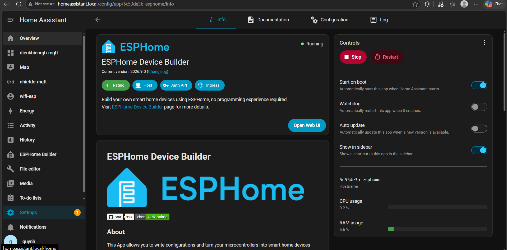
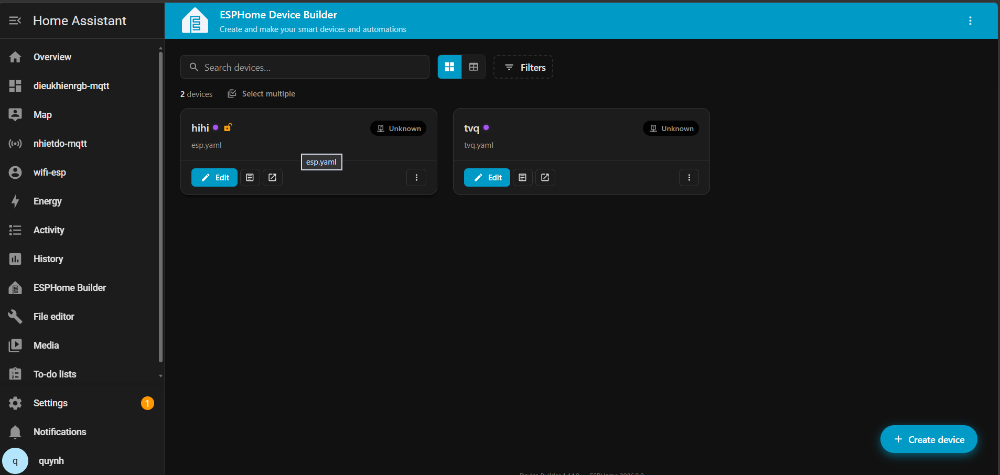
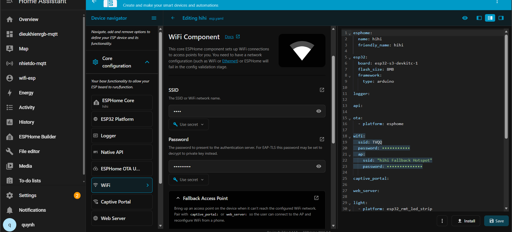
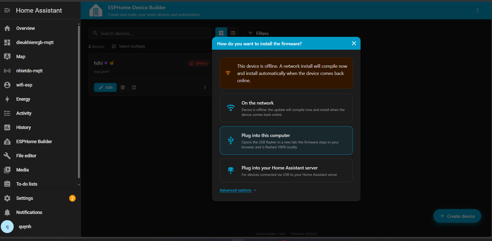
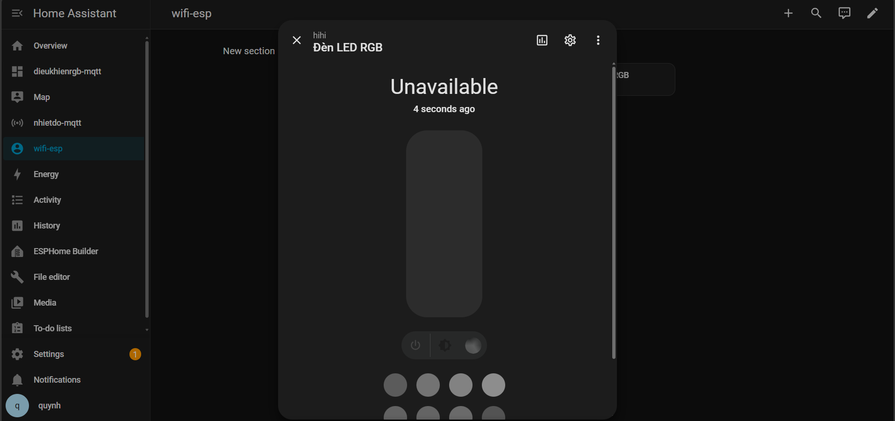

# BÀI THỰC HÀNH 8 — WI-FI VÀ ESPHOME

**Sinh viên:** Trịnh Văn Quynh  
**Nền tảng:** Home Assistant và ESPHome Device Builder.  
**Board khai báo trong ảnh:** ESP32-S3 DevKitC-1.  
**Nội dung có ảnh:** Cấu hình thiết bị ESPHome, lựa chọn cách nạp firmware và kiểm tra entity LED RGB.

> Báo cáo sử dụng 5 ảnh chụp do sinh viên cung cấp. Ảnh hiện có thể hiện ESPHome Builder đang chạy nhưng thiết bị hihi có trạng thái Offline, còn entity Đèn LED RGB là Unavailable. Chưa có minh chứng nạp firmware thành công hoặc LED vật lý đã đổi trạng thái.

## 1. Mục tiêu

- Sử dụng ESPHome Device Builder trong Home Assistant.
- Cấu hình thiết bị ESP32-S3 bằng YAML.
- Phân biệt ứng dụng Builder đang chạy với board đã kết nối mạng.
- Lựa chọn nạp USB hoặc cập nhật qua mạng phù hợp vị trí cắm board.
- Kiểm tra kết nối ESPHome integration và entity LED RGB.

## 2. Thành phần hệ thống

| Thành phần | Thông tin nhìn thấy trong ảnh |
|---|---|
| Home Assistant | Có giao diện quản lý và dashboard wifi-esp |
| ESPHome Device Builder | Phiên bản hiển thị 2026.9.0, trạng thái Running |
| Cấu hình thiết bị thứ nhất | Tên hihi, tệp esp.yaml |
| Cấu hình thiết bị thứ hai | Tên tvq, tệp tvq.yaml |
| Board trong esp.yaml | esp32-s3-devkitc-1 |
| Flash khai báo | 8MB — đây là cấu hình, chưa phải kết quả đọc flash từ phần cứng |
| Framework khai báo | arduino |
| Entity trên dashboard | Đèn LED RGB, thiết bị hiển thị hihi |

Đề mẫu bài 8.1 sử dụng Wemos D1 mini/ESP8266. Ảnh thực hành này chọn ESP32-S3, do đó cần dùng cấu hình, chân GPIO và firmware tương ứng ESP32-S3; không chép nguyên cấu hình board hoặc LED active-low của Wemos.

## 3. Bài 8.1 — Cấu hình ESPHome và kết nối Home Assistant

### 3.1. Mở và kiểm tra ESPHome Device Builder

Trình tự thực hiện:

1. Trong Home Assistant, mở Settings và vào khu vực quản lý ứng dụng/add-on của bản đang dùng.
2. Chọn ESPHome Device Builder.
3. Kiểm tra trạng thái Running; nếu ứng dụng chưa chạy thì khởi động.
4. Nhấn Open Web UI để mở trang quản lý thiết bị.



*Hình 1. Ứng dụng ESPHome Device Builder hiển thị phiên bản 2026.9.0 và trạng thái Running.*

Trong ảnh, Start on boot và Show in sidebar đang bật; Watchdog và Auto update đang tắt. Đây là tùy chọn của ứng dụng Builder, không phải trạng thái watchdog hoặc cơ chế khởi động của board ESP32-S3.

**Nhận xét:** có thể xác nhận ứng dụng Builder đang hoạt động ở thời điểm chụp. Không suy ra board đã online chỉ từ chữ Running trên trang này.

### 3.2. Xem danh sách cấu hình thiết bị

Sau khi mở Web UI, giao diện xuất hiện hai thẻ cấu hình:

- hihi — esp.yaml.
- tvq — tvq.yaml.



*Hình 2. Hai thiết bị được liệt kê trong Builder; cả hai có nhãn Unknown ở ảnh này.*

Nhấn Edit tại thẻ hihi để mở esp.yaml. Nút Create device dùng khi cần tạo cấu hình mới.

**Lưu ý:** có hai thẻ không chứng minh đang có hai board vật lý khác nhau. Nhãn Unknown là kết quả hiển thị của cơ chế kiểm tra trạng thái tại thời điểm chụp, chưa đủ kết luận chính xác về firmware hoặc nguồn của board.

### 3.3. Chỉnh cấu hình YAML của hihi



*Hình 3. Trình soạn thảo thiết bị hihi, phần WiFi Component và nội dung YAML bên phải.*

Các thông tin đọc được:

| Mục | Giá trị / vai trò |
|---|---|
| esphome.name | hihi — tên node khai báo |
| friendly_name | hihi — tên thân thiện |
| esp32.board | esp32-s3-devkitc-1 |
| flash_size | 8MB — cần đối chiếu dung lượng board thực tế |
| framework.type | arduino |
| logger | Có khai báo để hỗ trợ log |
| api | Có khai báo native API |
| ota | Có platform: esphome |
| wifi | Có cấu hình SSID và password |
| wifi.ap | Có fallback hotspot mang tên hihi Fallback Hotspot |
| captive_portal | Có khai báo |
| web_server | Có khai báo |
| light | Bắt đầu khai báo platform esp32_rmt_led_strip |

Mật khẩu Wi-Fi và fallback trong ảnh đã được che; báo cáo không bổ sung hoặc suy đoán các mật khẩu đó.

**Đoạn khai báo board được chép theo phần nhìn thấy trong ảnh:**

```yaml
esphome:
  name: hihi
  friendly_name: hihi

esp32:
  board: esp32-s3-devkitc-1
  flash_size: 8MB
  framework:
    type: arduino
```

Đoạn trên chỉ minh họa phần cấu hình core/board, **không phải file YAML đầy đủ để nạp**. Khối light bị cắt ở cuối ảnh nên chưa xác định được chân RGB, số LED, chipset hoặc thứ tự màu. Cần xem toàn bộ esp.yaml trước khi kết luận cấu hình LED đúng.

Trình tự kiểm tra cấu hình:

1. Đối chiếu board và dung lượng flash khai báo với phần cứng.
2. Kiểm tra Wi-Fi đúng SSID/password, board có thể truy cập mạng đó.
3. Xem toàn bộ light để xác định đúng chân và loại LED.
4. Lưu cấu hình bằng Save.
5. Kiểm tra cấu hình/biên dịch bằng chức năng tương ứng của Builder, giữ lại log nếu có lỗi.

### 3.4. Chọn phương thức nạp firmware

Nhấn Install để mở cửa sổ lựa chọn cách nạp.



*Hình 4. Thiết bị hihi hiển thị Offline. Hộp thoại có On the network, Plug into this computer và Plug into your Home Assistant server.*

| Lựa chọn | Khi nào dùng? |
|---|---|
| On the network | Cập nhật qua mạng khi board truy cập được và đã có firmware hỗ trợ OTA phù hợp |
| Plug into this computer | Board cắm USB vào máy tính đang mở trình duyệt; giao diện mô tả sẽ mở USB flasher ở tab mới |
| Plug into your Home Assistant server | Board cắm USB vào máy chủ Home Assistant hoặc đã được chuyển USB đúng vào máy ảo HA |

Cảnh báo trong ảnh nêu thiết bị đang offline: nếu chọn nạp qua mạng, hệ thống có thể biên dịch trước và chờ cài đặt khi thiết bị online trở lại. Vì vậy, **biên dịch được không đồng nghĩa firmware đã truyền xuống board**.

Nếu board chưa từng được nạp ESPHome hoặc chưa vào Wi-Fi, ưu tiên nạp USB đúng vị trí cắm thiết bị. Nếu HA chạy trong VirtualBox, không mặc định board cắm ở laptop đã được máy ảo nhận; kiểm tra USB passthrough và cổng mà bên nạp thực sự nhìn thấy.

Ảnh chỉ cho thấy hộp thoại lựa chọn. Chưa có cửa sổ hoàn tất upload, log boot hoặc IP của ESP sau khi nạp.

### 3.5. Kiểm tra entity trên Home Assistant

Trên dashboard wifi-esp, mở entity Đèn LED RGB để xem chi tiết.



*Hình 5. Entity thuộc thiết bị hiển thị hihi và có trạng thái Unavailable; các nút điều khiển bị làm mờ.*

**Nhận xét:** Home Assistant đã có entity LED RGB trên giao diện nhưng không có trạng thái khả dụng tại thời điểm chụp. Không mô tả ảnh này là bằng chứng LED đang tắt hoặc điều khiển thành công.

- **Off**: entity khả dụng và báo trạng thái tắt.
- **Unavailable**: Home Assistant không có trạng thái khả dụng của entity lúc đó.
- **Offline trong Builder**: Builder không xác nhận được thiết bị online theo cơ chế kiểm tra của nó; cần đối chiếu log và kết nối API.

Các trạng thái trên có liên quan nhưng không hoàn toàn đồng nghĩa. Ảnh hiện tại chưa xác định nguyên nhân duy nhất gây lỗi.

## 4. Kiểm tra tiếp để hoàn thiện bài 8.1

### Bước 1 — Nguồn, USB và board

- Kiểm tra board có nguồn và cáp USB truyền dữ liệu.
- Xác định đúng cổng USB/serial và chương trình đang sử dụng cổng.
- Khi nạp lần đầu, chọn đường USB tương ứng với vị trí cắm board.
- Nếu công cụ yêu cầu chế độ nạp, làm theo hướng dẫn BOOT/RESET của đúng board.

### Bước 2 — Log biên dịch và nạp

- Xác nhận không còn lỗi cấu hình hoặc biên dịch.
- Phân biệt log build với log upload thành công.
- Sau khi nạp, xem log qua USB để biết firmware có boot bình thường không.

### Bước 3 — Wi-Fi và IP

- Xem log kết nối Wi-Fi, lý do thất bại nếu có và địa chỉ IP được cấp.
- Đối chiếu IP với danh sách DHCP của router nếu cần.
- Nếu Builder không tìm được hostname .local nhưng IP vẫn truy cập được, kiểm tra mDNS/thông tin địa chỉ thay vì kết luận board hỏng.
- Fallback hotspot chỉ hỗ trợ dự phòng khi cấu hình cho phép; không tự chứng minh board đã nối mạng Wi-Fi chính.

### Bước 4 — ESPHome integration trong HA

- Mở Settings → Devices & Services, tìm thiết bị ESPHome tương ứng.
- Kiểm tra host/IP và thông tin xác thực mà integration yêu cầu.
- Nếu cùng MAC đã được cấu hình bằng tên khác, đối chiếu thiết bị hiện có trước khi tạo cấu hình trùng.
- Xem thông báo lỗi kết nối hoặc xác thực để xác định hướng xử lý.

### Bước 5 — Thử LED sau khi entity khả dụng

- Xác nhận entity hết Unavailable.
- Gửi lệnh bật/tắt và đổi màu từ Home Assistant.
- Quan sát LED vật lý trên board.
- Nếu HA đổi trạng thái nhưng LED không đổi, kiểm tra chân GPIO, loại LED địa chỉ, chipset, số LED và thứ tự màu trong khối light.
- Chụp màn hình cùng ảnh board để đối chiếu yêu cầu và kết quả thực tế.

## 5. Bài 8.2 — Phân tích gói Wi-Fi: chưa có ảnh capture

Năm ảnh gửi lần này chưa có Wireshark, vì vậy chưa ghi frame number, IP ESP hoặc kết quả phân tích gói mạng như đã quan sát thực tế.

Khi thực hiện tiếp:

1. Capture tại vị trí thấy được luồng HA–ESP, không chỉ dựa vào việc cùng Wi-Fi.
2. Quan sát ARP, DHCP, mDNS và kết nối API nếu các gói đó thực sự xuất hiện.
3. Khởi động board trong lúc capture để theo dõi quá trình kết nối.
4. Thử OTA khi board đã khả dụng, đối chiếu port thực tế.
5. Chụp gói tiêu biểu và ghi chức năng, source/destination, thời gian và frame number.

Cổng OTA mặc định của ESPHome khác theo nền tảng: ESP32 thường dùng 3232, ESP8266 thường dùng 8266; giá trị có thể cấu hình lại. Không dùng cổng của Wemos làm mặc định cho cấu hình S3 mà không kiểm tra.

## 6. Bài 8.3 — Cảm biến: chưa có ảnh minh chứng

Ảnh hiện tại chưa cho thấy wiring cảm biến, cấu hình sensor hoặc entity nhiệt độ/độ ẩm thuộc thiết bị ESPHome này. Các tên dashboard có chữ mqtt ở thanh bên không thay thế bằng chứng sensor của bài 8.3.

Để bổ sung:

1. Ghi loại cảm biến và chân kết nối thực tế.
2. Khai báo component/pin/model phù hợp trong YAML.
3. Nạp firmware và kiểm tra log đọc cảm biến.
4. Thêm entity nhiệt độ/độ ẩm vào HA, chụp giá trị và đơn vị.

## 7. Bài 8.4 — Automation: chưa có ảnh minh chứng

Chưa có ảnh trigger, condition, action hoặc trace của automation. Khi thực hiện tiếp, cần ghi entity_id cảm biến/LED thật, ngưỡng điều khiển, hành động và kết quả thử.

Nếu dùng hai ngưỡng bật/tắt, nêu rõ vùng giữ trạng thái giữa hai ngưỡng để tránh nhấp nháy khi số đo dao động. Không ghi automation đã chạy chỉ vì đã có entity LED trên dashboard.

## 8. Giải thích các khái niệm của bài 8.1

| Khái niệm | Giải thích |
|---|---|
| YAML | Cấu hình đầu vào để ESPHome tạo và biên dịch firmware; chỉnh file không tự thay firmware trên board |
| Firmware | Chương trình nhị phân được nạp vào vi điều khiển |
| Native API | Kênh để HA và ESPHome trao đổi dữ liệu, trạng thái và lệnh |
| OTA | Cập nhật firmware qua mạng, cần thiết bị và đường cập nhật phù hợp |
| mDNS | Cơ chế phân giải tên cục bộ thường dùng tên .local; khác với hỏi DNS server thông thường |
| Fallback AP | Điểm truy cập dự phòng được cấu hình trên thiết bị khi cần hỗ trợ truy cập/cấu hình mạng |
| Captive portal | Thành phần hỗ trợ giao diện cấu hình trong tình huống dự phòng thích hợp |
| web_server | Thành phần cung cấp giao diện web trên thiết bị; có trong YAML chưa chứng minh web đang truy cập được |

### Vì sao Builder Running nhưng LED vẫn Unavailable?

Builder là ứng dụng quản lý/biên dịch cấu hình, còn board là thiết bị chạy firmware và kết nối HA. Builder hoạt động không bảo đảm board có nguồn, đã nạp đúng firmware, đã vào Wi-Fi hoặc API đang kết nối.

### Tại sao có thể cập nhật không dây?

Sau khi firmware hỗ trợ OTA đã chạy và đường mạng truy cập được, firmware mới có thể được truyền qua mạng thay cho USB. OTA không khắc phục được mọi trường hợp sai Wi-Fi hoặc board chưa có firmware ban đầu; khi đó có thể cần nạp lại qua USB.

### Có thể lấy flash_size: 8MB làm thông số phần cứng đã xác nhận không?

Không. Ảnh chỉ thể hiện giá trị đang khai báo. Cần đối chiếu mã module, tài liệu board hoặc thông tin do công cụ nạp đọc được để xác nhận dung lượng flash thực tế.

## 9. Tổng kết tiến độ theo ảnh

| Công việc | Bằng chứng | Trạng thái phù hợp |
|---|---|---|
| Khởi chạy ESPHome Device Builder | Hình 1 | Running |
| Có cấu hình hihi và tvq | Hình 2 | Hai thẻ cấu hình xuất hiện |
| Khai báo ESP32-S3 và Wi-Fi | Hình 3 | Có cấu hình; chưa đủ log xác nhận hoạt động |
| Chọn cách nạp firmware | Hình 4 | Đã mở lựa chọn; thiết bị đang Offline |
| Có entity LED RGB trong HA | Hình 5 | Có giao diện entity nhưng Unavailable |
| Nạp thành công, có IP và điều khiển LED vật lý | Chưa có ảnh | Cần bổ sung kết quả |
| Wireshark, cảm biến và automation | Chưa có ảnh | Chưa kết luận cho 8.2–8.4 |

## 10. Kết luận

Các ảnh ghi nhận quá trình chuẩn bị ESPHome cho ESP32-S3 và đưa entity LED RGB lên giao diện Home Assistant. Tại thời điểm chụp, board chưa được xác nhận kết nối khả dụng: Builder hiển thị Offline ở bước cài firmware và entity báo Unavailable. Bước tiếp theo là kiểm tra nạp USB, log boot/Wi-Fi và kết nối API, sau đó mới xác nhận điều khiển LED thành công.

---

**Nguồn ảnh:** 5 ảnh chụp do sinh viên cung cấp ngày 18/10/2026. Các ảnh được sắp theo trình tự thao tác, không khẳng định là lịch sử thời gian của một lần nạp duy nhất.  
**Nguồn yêu cầu:** BTH8_WiFi.pdf trong bộ đề đã đối chiếu.  
**Tham khảo:** [ESPHome FAQ](https://esphome.io/guides/faq/) và [ESPHome OTA](https://esphome.io/components/ota/esphome/).  
**Đưa lên GitHub:** giữ `BTH08.md` và thư mục `images` cạnh nhau.
