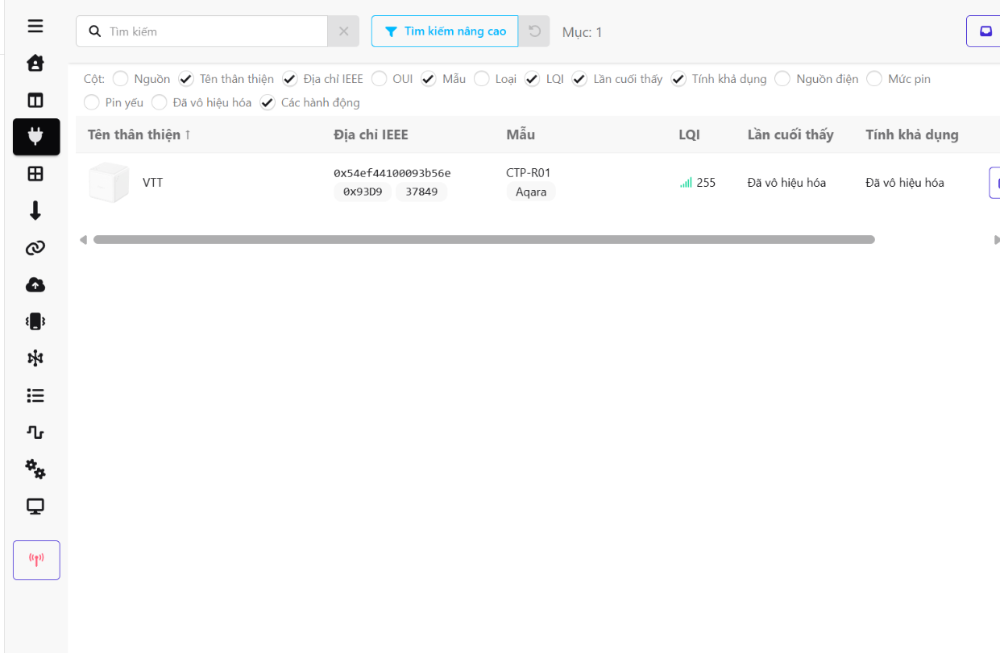
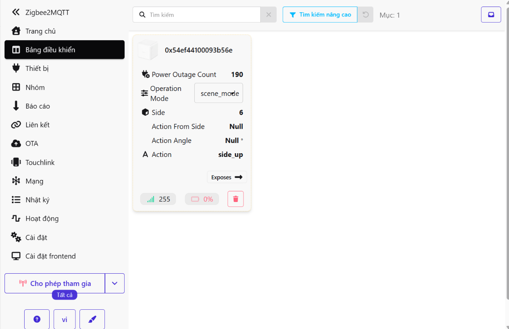
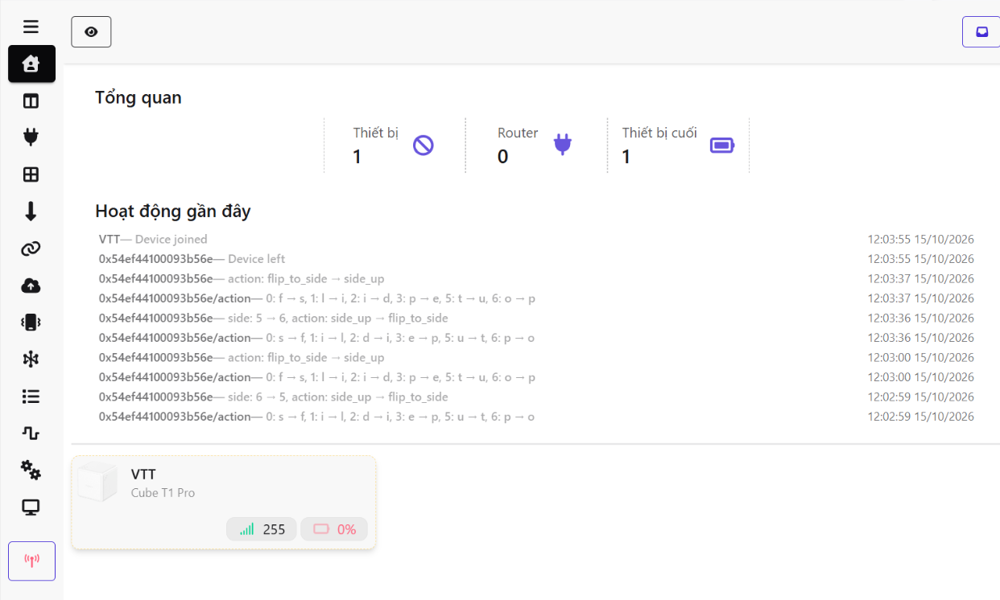

# BÀI THỰC HÀNH 6 – GIAO THỨC ZIGBEE

**Sinh viên:** Trịnh Văn Quynh  
**Nội dung:** Kết nối thiết bị Zigbee, quan sát sự kiện trên Zigbee2MQTT và hướng dẫn phân tích gói tin bằng ZBOSS Sniffer/Wireshark.

> Báo cáo sử dụng 3 ảnh thực hành được cung cấp. Các ảnh chứng minh thiết bị và sự kiện trên giao diện Zigbee2MQTT; chưa phải ảnh bắt gói Wireshark. Các mục cần capture được đánh dấu để bổ sung, không điền thông số suy đoán.

## 1. Mục tiêu

- Phân biệt Coordinator, Router và End Device.
- Nhận diện thiết bị, địa chỉ IEEE và địa chỉ mạng ngắn.
- Theo dõi sự kiện đổi mặt của Aqara Cube T1 Pro.
- Thực hiện tiếp các mục 6.1 bắt gói; 6.2 APS/ZCL; 6.3 quá trình join và bảo mật.

## 2. Hệ thống thực hành

Thiết bị Cube truyền Zigbee tới coordinator. Zigbee2MQTT giao tiếp với coordinator và chuyển dữ liệu sang MQTT broker; Home Assistant có thể sử dụng dữ liệu MQTT để tạo tự động hóa. Giao diện Zigbee2MQTT hiển thị dữ liệu đã được phần mềm xử lý.

| Thành phần | Vai trò | Bằng chứng hiện có |
|---|---|---|
| Aqara Cube T1 Pro, mẫu CTP-R01 | Thiết bị cuối, phát sinh sự kiện thao tác | Có trong ảnh |
| Coordinator Zigbee | Tạo và quản lý mạng | Có vai trò trong mô hình; ảnh chưa xác định model dongle |
| Zigbee2MQTT | Quản lý thiết bị và chuyển đổi dữ liệu | Có giao diện và nhật ký |
| MQTT broker/Home Assistant | Nhận dữ liệu và tự động hóa | Chưa có ảnh cấu hình/kết quả riêng |
| Dongle sniffer + ZBOSS + Wireshark | Thu và phân tích frame Zigbee | Chưa có ảnh capture |

**Lưu ý:** ESP32-S3 thông thường không có radio IEEE 802.15.4 tích hợp để trực tiếp bắt Zigbee. Bài này không cần nạp sketch ESP32; cần coordinator và phần cứng sniffer tương thích. Không dùng cùng một dongle đồng thời làm coordinator và sniffer.

## 3. Kết quả thực tế từ ảnh

### 3.1. Danh sách thiết bị



**Cách đọc:** Thiết bị → dòng VTT → địa chỉ IEEE → model → LQI.

| Trường | Giá trị quan sát | Ý nghĩa |
|---|---|---|
| Tên thân thiện | `VTT` | Tên hiển thị hiện tại |
| Địa chỉ IEEE | `0x54ef44100093b56e` | Định danh mở rộng 64 bit |
| Địa chỉ mạng | `0x93D9` / `37849` | Hai cách viết hex/thập phân của cùng địa chỉ 16 bit |
| Hãng/model | Aqara / `CTP-R01` | Cube T1 Pro |
| LQI | `255` | Giá trị chất lượng liên kết được báo; không phải RSSI tính bằng dBm |
| Lần cuối thấy | Đã vô hiệu hóa | Tính năng hiển thị last_seen đang tắt |
| Tính khả dụng | Đã vô hiệu hóa | Theo dõi availability đang tắt; không đồng nghĩa thiết bị offline |

Địa chỉ ngắn được cấp trong mạng và có thể thay đổi sau khi tham gia lại. Không sử dụng `0x93D9` làm định danh cố định cho mọi lần đo.

### 3.2. Trạng thái Cube



**Cách đọc:** Bảng điều khiển → thẻ Cube → Operation Mode → Side → Action.

| Thuộc tính | Giá trị trên ảnh |
|---|---|
| Tên thẻ tại thời điểm chụp | `0x54ef44100093b56e` |
| Operation Mode | `scene_mode` |
| Side | `6` |
| Action | `side_up` |
| Action From Side | `Null` |
| Action Angle | `Null` |
| Power Outage Count | `190` |
| LQI | `255` |
| Pin hiển thị | `0%` |

Ảnh cho thấy trạng thái mặt 6 và hành động `side_up`. `Null` không có nghĩa góc bằng 0; trường có thể không áp dụng hoặc không có giá trị trong trạng thái đó. Chỉ ghi nhận bộ đếm 190 theo giao diện, chưa suy ra nguyên nhân. Pin hiển thị 0% cần kiểm tra lại bằng bản tin mới hoặc pin thực tế; không kết luận pin đã cạn chỉ từ ảnh này.

### 3.3. Tổng quan và sự kiện



**Cách đọc:** Trang chủ → Tổng quan → Hoạt động gần đây → thẻ VTT.

- Giao diện thống kê **1 thiết bị, 0 router, 1 thiết bị cuối**. Không diễn giải là mạng không có coordinator; thống kê thiết bị thường không tính coordinator như thiết bị đã ghép nối.
- Có các thay đổi mặt `6 → 5` và `5 → 6`, với hành động `flip_to_side` và `side_up`.
- Có các mục `Device left` dưới địa chỉ IEEE và `Device joined` dưới tên VTT. Chúng cho thấy phần mềm đã ghi nhận rời/tham gia; ảnh chưa đủ xác định nguyên nhân hoặc toàn bộ thủ tục join.
- Một số dòng `.../action` hiển thị các ký tự thay đổi theo vị trí. Chưa có payload gốc để kết luận đây là nhiều hành động riêng hay cách frontend hiển thị so sánh chuỗi.

**Nhận xét:** Cùng địa chỉ IEEE xuất hiện giữa các ảnh giúp đối chiếu thiết bị, dù có ảnh còn hiển thị địa chỉ thay vì tên VTT.

## 4. Thực hiện lại phần Zigbee2MQTT

### Bước 1 – Kiểm tra hệ thống đang chạy

1. Mở Zigbee2MQTT từ hệ thống hiện có.
2. Kiểm tra nhật ký khởi động: coordinator được nhận, kết nối broker thành công.
3. Nếu dùng Home Assistant trong VirtualBox, kiểm tra USB coordinator đã được chuyển cho máy ảo và không bị ứng dụng khác giữ.
4. Không cho ZHA và Zigbee2MQTT đồng thời sử dụng một coordinator.

### Bước 2 – Ghép nối Cube khi cần

1. Nếu VTT đang hoạt động thì giữ nguyên thiết bị để quan sát, không cần ghép lại.
2. Khi thực sự cần thêm lại: chọn **Cho phép tham gia**, sau đó đưa Cube vào chế độ pairing theo hướng dẫn nhà sản xuất.
3. Chờ nhật ký nhận thiết bị và hoàn tất phỏng vấn; kiểm tra model CTP-R01.
4. Đặt tên thân thiện VTT nếu muốn thống nhất với báo cáo.
5. Tắt cho phép tham gia sau khi hoàn tất.

### Bước 3 – Tạo và đối chiếu sự kiện

1. Mở Bảng điều khiển; kiểm tra chế độ hiện tại là `scene_mode` như ảnh.
2. Đặt mặt 5 hướng lên; chờ một lúc rồi lật sang mặt 6.
3. Theo dõi `Side` và `Action`; mở Hoạt động gần đây để đối chiếu thời gian.
4. Lặp lại 3–5 lần và ghi nhận giá trị thực tế, không yêu cầu mọi phiên bản phần mềm phải hiển thị cùng chuỗi sự kiện theo cùng thứ tự.
5. Chụp ảnh bảng điều khiển và nhật ký sau thao tác.

### Bước 4 – Quan sát MQTT (bổ sung)

Nếu có công cụ `mosquitto_sub`, thay địa chỉ broker và tài khoản đúng với hệ thống:

```bash
mosquitto_sub -h BROKER_IP -p 1883 -u MQTT_USER -t 'zigbee2mqtt/VTT' -v
```

Cấu hình xác thực theo cách hệ thống cho phép; lệnh có thể yêu cầu mật khẩu hoặc thêm tùy chọn phù hợp. `zigbee2mqtt` là base topic mặc định, cần thay nếu cấu hình khác. Nếu chưa chắc tên topic, dùng công cụ lắng nghe MQTT trong Home Assistant với `zigbee2mqtt/#` trong thời gian ngắn để tìm đúng topic.

Payload dưới đây **chỉ là ví dụ minh họa cấu trúc, không trích từ ảnh**:

```json
{"action":"side_up","side":6,"operation_mode":"scene_mode","linkquality":255}
```

Không suy ra một gói ZCL cụ thể chỉ từ JSON; cần đối chiếu timestamp và capture.

## 5. Bài 6.1 – Sniff và phân tích gói tin

### 5.1. Chuẩn bị

- Giữ coordinator đang vận hành mạng Zigbee.
- Dùng sniffer riêng, ví dụ CC2531 có firmware tương thích đúng bản ZBOSS Sniffer sử dụng trong tài liệu môn học.
- Cài Wireshark, driver và ZBOSS phù hợp hệ điều hành.
- Xác định kênh mạng đang sử dụng từ cấu hình/trạng thái coordinator của Zigbee2MQTT. **Ba ảnh chưa có thông tin kênh, không tự điền 11/15/20/25.**

### 5.2. Bắt gói từng bước

1. Cắm sniffer vào máy chạy ZBOSS, kiểm tra cổng COM thực tế trong Device Manager. COM trong tài liệu chỉ là ví dụ.
2. Mở ZBOSS Sniffer GUI, chọn sniffer/cổng và thiết lập đường dẫn Wireshark theo bản đang dùng.
3. Chọn **đúng kênh Zigbee của mạng**. Không đổi kênh mạng chỉ để khớp ví dụ.
4. Start capture, kiểm tra Wireshark nhận frame IEEE 802.15.4/Zigbee.
5. Lật Cube 5 → 6 và 6 → 5, ghi thời điểm thao tác.
6. Dừng sau khoảng 10–20 giây, lưu `TH6_1_Cube.pcapng`.
7. Thử bộ lọc `wpan`, `zbee_nwk`, `zbee_aps`, `zbee_zcl`; kiểm tra thanh filter báo hợp lệ.
8. Chọn frame, mở các tầng MAC → NWK → APS → ZCL. Không phải frame nào cũng có đủ các tầng, ví dụ MAC ACK.

**Điểm dễ nhầm:** Bắt giao diện Wi-Fi/Ethernet của máy chủ có thể thấy MQTT nhưng không thay thế việc bắt frame Zigbee trên radio.

### 5.3. Giải mã

1. Trên mạng thực hành của mình, lấy Network Key từ cấu hình/backup coordinator theo cách hệ thống hiện tại lưu trữ. Tên file thường gặp là `coordinator_backup.json`; vị trí tùy kiểu cài đặt.
2. Trong Wireshark, mở Edit → Preferences → Protocols → Zigbee và mục khóa giải mã tương ứng phiên bản.
3. Nhập đúng Network Key 16 byte và thứ tự byte, áp dụng rồi tải lại capture nếu cần.
4. Khi phân tích join sử dụng khóa mặc định của cơ chế tương ứng, khóa thường được tài liệu minh họa bằng chuỗi `ZigBeeAlliance09` (16 byte). Khóa này không bảo đảm giải mã được mọi mạng/join: install code và khóa riêng cần vật liệu khóa phù hợp.
5. Không chèn Network Key thật, mật khẩu MQTT hoặc backup coordinator vào báo cáo/GitHub.

### 5.4. Bảng kết quả cần điền từ frame

| Trường | Kết quả |
|---|---|
| Frame number | Chưa có capture |
| PAN ID | Chưa có capture |
| Channel | Chưa có cấu hình/capture xác nhận |
| MAC source/destination | Chưa có capture |
| NWK source/destination | Chưa có capture |
| Sequence number, ghi rõ tầng | Chưa có capture |
| APS source/destination endpoint | Chưa có capture |
| Profile ID / Cluster ID | Chưa có capture |
| ZCL command ID | Chưa có capture |

`0x93D9` là địa chỉ thiết bị hiển thị trên ảnh Zigbee2MQTT, chưa phải bằng chứng rằng một frame cụ thể dùng địa chỉ đó. MAC source/destination có thể là các nút ở từng chặng, khác với NWK source/destination đầu cuối.

**Trả lời lý thuyết:** Mạng Zigbee thông dụng với thiết bị trong bài dùng băng 2,4 GHz; kênh IEEE 802.15.4 ở băng này là 11–26. Địa chỉ IEEE dài 64 bit, còn địa chỉ mạng ngắn 16 bit được dùng trong mạng. MAC sequence, NWK sequence và ZCL transaction sequence là các trường khác nhau, cần ghi rõ trường đang đọc.

## 6. Bài 6.2 – Phân tích APS/ZCL

1. Bắt gói trong lúc thao tác Cube, giải mã nếu cần.
2. Lọc `zbee_zcl`, đối chiếu thời gian với nhật ký Zigbee2MQTT.
3. Mở APS để đọc source/destination endpoint, Profile ID và Cluster ID.
4. Mở ZCL để đọc frame type, direction, transaction sequence và command ID.
5. Ghi payload thực tế rồi mới liên hệ với `side_up` hoặc `flip_to_side`.

| Nội dung | Frame A | Frame B |
|---|---|---|
| Thao tác | Lật sang mặt 5 | Lật sang mặt 6 |
| Frame number | Cần bổ sung | Cần bổ sung |
| Source / Destination | Cần bổ sung | Cần bổ sung |
| Endpoint nguồn/đích | Cần bổ sung | Cần bổ sung |
| Profile / Cluster / Command | Cần bổ sung | Cần bổ sung |
| Phản hồi nếu có | Cần đối chiếu | Cần đối chiếu |

**Yêu cầu On/Off trong đề:** Cube là thiết bị sự kiện, ba ảnh chưa có đèn/công tắc và chưa chứng minh lệnh On/Off. Để hoàn thành đúng mục này, bổ sung thiết bị hỗ trợ On/Off, bật và tắt rồi chọn hai frame tương ứng. Cluster On/Off chuẩn là `0x0006`; với lệnh cluster-specific, Off là `0x00`, On là `0x01`, Toggle là `0x02`. Không áp các mã này cho mọi cluster hoặc cho các ZCL global command.

**ZCL** là thư viện mô tả các cluster ứng dụng Zigbee. **Cluster** nhóm thuộc tính và lệnh của một chức năng. **Profile ID** xác định ngữ cảnh ứng dụng để các thiết bị diễn giải dịch vụ thống nhất. Zigbee2MQTT chuyển đổi frame thành trạng thái/sự kiện dễ dùng, nên chuỗi action không phải bản sao nguyên vẹn của frame radio.

## 7. Bài 6.3 – Join và bảo mật

1. Ghi lại trạng thái hiện tại, chỉ thực hiện ghép lại trên thiết bị thực hành cần thử.
2. Chuẩn bị sniffer đúng kênh và bắt **trước** khi bật permit join/đưa thiết bị vào pairing.
3. Bật cho phép tham gia; thực hiện pairing theo hướng dẫn Cube.
4. Chờ Zigbee2MQTT nhận thiết bị, dừng capture và lưu `TH6_3_Join.pcapng`.
5. Xem NWK/APS và các command liên quan bảo mật, tìm Transport Key nếu capture có chứa và giải mã được.
6. Ghi frame number, source, destination, tầng và cơ chế bảo vệ quan sát được. Tắt permit join khi kết thúc.

| Bằng chứng | Tình trạng |
|---|---|
| Nhật ký Device left / Device joined | Có trong ảnh 3 |
| Frame join/association/rejoin | Chưa có capture |
| APS Transport Key | Chưa có capture |
| Phân phối Network Key được giải mã | Chưa có capture |

Trong mô hình mạng tập trung thường gặp, thiết bị tham gia và được Trust Center quản lý/cấp quyền; Network Key được phân phối bằng cơ chế bảo mật phù hợp. Luồng join, rejoin và trao đổi khóa có thể khác nhau, không bắt buộc mọi lần đều xuất hiện cùng một chuỗi frame.

- **Network Key:** bảo vệ lưu lượng ở tầng mạng của mạng Zigbee.
- **Trust Center Link Key:** khóa liên kết với Trust Center, có thể bảo vệ quá trình phân phối khóa và giao tiếp bảo mật tương ứng.
- **Giải mã join:** cần khóa và ngữ cảnh phù hợp với cơ chế join; khóa mặc định chỉ áp dụng khi mạng thực sự sử dụng nó.
- **Giải mã traffic sau join:** thường cần đúng Network Key đang dùng, cùng capture có đủ thông tin cần thiết.

Ảnh nhật ký tham gia không chứng minh đã bắt/giải mã Transport Key.

## 8. Lỗi thường gặp

| Hiện tượng | Cách kiểm tra |
|---|---|
| Không thấy frame Zigbee | Sniffer/firmware/COM, đúng kênh, đúng thiết bị capture |
| Thấy NWK nhưng chưa thấy ZCL | Network Key, thứ tự byte, loại frame, khả năng giải mã |
| Có action nhưng không thấy gói trên Wireshark | Có thể đang bắt Wi-Fi/MQTT thay vì radio Zigbee |
| Cube không báo sự kiện | Pin, thức thiết bị, chế độ hiện tại, thử thao tác và xem log |
| Hiện availability đã vô hiệu hóa | Đây là trạng thái tính năng giám sát, kiểm tra log/bản tin mới |
| Pin 0% nhưng vẫn có sự kiện | Đọc lại bản tin pin, kiểm tra pin thực; chưa kết luận chỉ qua thẻ |
| Coordinator không nhận trong máy ảo | USB passthrough, driver/quyền, chương trình khác giữ cổng |

## 9. Kết luận và nội dung cần bổ sung

Đã có bằng chứng Zigbee2MQTT nhận Aqara Cube T1 Pro, hiển thị IEEE `0x54ef44100093b56e`, địa chỉ mạng `0x93D9`, chế độ `scene_mode`, mặt 6 và các sự kiện đổi mặt. Giao diện ghi nhận một thiết bị cuối, không có router được thống kê.

Để hoàn thành đầy đủ đề 6.1–6.3, cần bổ sung: capture `.pcapng`; ảnh MAC/NWK và APS/ZCL; hai frame On/Off của thiết bị thích hợp; frame join và Transport Key nếu quan sát được. Chưa có cơ sở kết luận đã hoàn thành sniff hoặc giải mã bảo mật từ ba ảnh hiện tại.

## 10. Tài liệu tham khảo

- Tài liệu môn học: BTH6_ZigBee, các mục 6.1–6.3.
- [Aqara CTP-R01 – Zigbee2MQTT](https://www.zigbee2mqtt.io/devices/CTP-R01.html)
- [MQTT topics – Zigbee2MQTT](https://www.zigbee2mqtt.io/guide/usage/mqtt_topics_and_messages.html)
- [Device availability – Zigbee2MQTT](https://www.zigbee2mqtt.io/guide/configuration/device-availability.html)
- [Wireshark APS fields](https://www.wireshark.org/docs/dfref/z/zbee_aps.html)
- [Wireshark ZCL fields](https://www.wireshark.org/docs/dfref/z/zbee_zcl.html)

## 11. Code bổ sung – MQTT và Home Assistant

Đây là phần ứng dụng bổ sung cho Cube, không thay thế capture và giải mã Wireshark trong 6.1–6.3. Không cần nạp code vào Cube hoặc ESP32.

### 11.1. Các file

| File | Công dụng |
|---|---|
| [cube_monitor.py](code/cube_monitor.py) | Nhận JSON MQTT, in sự kiện và lưu JSONL |
| [requirements.txt](code/requirements.txt) | Thư viện Paho MQTT 2.x |
| [cube_light_automation.yaml](code/cube_light_automation.yaml) | Mặt 6 bật đèn, mặt 5 tắt đèn |

### 11.2. Chạy Python trên Windows

1. Cài Python 3, mở PowerShell trong thư mục đã giải nén, rồi mở thư mục code:

```powershell
cd .\code
py -m pip install -r requirements.txt
```

2. Kiểm tra bằng dữ liệu mô phỏng, không cần broker:

```powershell
py .\cube_monitor.py --demo --output demo_events.jsonl
```

Chương trình in hai bản ghi mặt 5 và 6, đánh dấu `synthetic: true`. Đây không phải dữ liệu thực nghiệm.

3. Chạy thật, thay IP và tài khoản bằng thông tin MQTT broker của bạn:

```powershell
py .\cube_monitor.py --host 192.168.1.133 --username MQTT_USER --topic zigbee2mqtt/VTT
```

IP trên chỉ là ví dụ. Nhập mật khẩu khi được hỏi; ký tự không hiển thị lúc nhập. Nếu broker không yêu cầu tài khoản, bỏ `--username MQTT_USER`. Có thể dùng biến môi trường `MQTT_PASSWORD` thay cho nhập tương tác. Broker TLS cần thêm `--tls --port 8883` và chứng chỉ được máy tin cậy theo cấu hình thực tế.

4. Lật Cube, theo dõi `action`, `side`, `linkquality`, `battery`. File `cube_events.jsonl` được thêm bản ghi trong thư mục chạy lệnh; Ctrl+C để dừng.
5. Bản ghi nhận lại từ broker có `retained: true`; không mặc định coi đó là thao tác vừa xảy ra. Không có trường dữ liệu thì chương trình ghi `null`.

Nếu không có bản tin: kiểm tra IP broker, cổng, mật khẩu, Cube có hoạt động không và tên topic. Với tên trước khi đổi, topic có thể là `zigbee2mqtt/0x54ef44100093b56e`; base topic cũng có thể khác. Kiểm tra topic thực tế bằng chức năng lắng nghe MQTT trong Home Assistant.

### 11.3. Thêm automation Home Assistant

1. Đảm bảo tích hợp MQTT trong Home Assistant kết nối đúng broker của Zigbee2MQTT.
2. Vào Công cụ dành cho nhà phát triển → Trạng thái, tìm entity đèn thật, ví dụ `light.den_phong`.
3. Mở `cube_light_automation.yaml`, đổi **cả hai** chỗ `light.den_thuc_hanh` thành entity thật. Nếu thiết bị là `switch.*`, đổi cả entity và các action thành `switch.turn_on` / `switch.turn_off`.
4. Kiểm tra topic `zigbee2mqtt/VTT` đúng tên phân biệt chữ hoa/thường; Cube đang ở `scene_mode`.
5. Vào Cài đặt → Tự động hóa & cảnh → Tạo tự động hóa mới → tạo trống → menu → Chỉnh sửa bằng YAML.
6. Dán toàn bộ nội dung file YAML, lưu và bật automation. Đây là **một automation**, không phải cấu hình để dán nguyên văn dưới `mqtt:` trong `configuration.yaml`. Khi thêm trực tiếp vào `automations.yaml` dạng danh sách, phải đặt dấu `-` trước `alias` và thụt toàn bộ nội dung còn lại đúng cấp.
7. Đặt mặt 6 hướng lên rồi mặt 5; xem đèn và mục Trace/Dấu vết của automation.

Code chỉ phản ứng khi JSON có `action` là `side_up` hoặc `flip_to_side`, đồng thời `side` là 5/6. Bản tin chỉ cập nhật pin hoặc LQI sẽ không kích hoạt điều khiển. Hai sự kiện cùng mặt có thể gọi bật/tắt lặp lại, nhưng không dùng toggle nên không đảo trạng thái ngoài ý muốn.

Không dùng nút Chạy hành động để kiểm tra nhánh phụ thuộc `trigger.payload_json` vì chạy tay không có bản tin trigger. Hãy tạo sự kiện thật từ Cube. Không retain các bản tin hành động; broker giữ action cũ có thể khiến tự động hóa chạy khi đăng ký lại.

### 11.4. Kiểm tra và giới hạn

- Python đã kiểm tra cú pháp và chạy demo offline hai bản ghi.
- Đã kiểm tra parser với JSON hợp lệ, JSON lỗi và dữ liệu không phải object; YAML được kiểm tra cấu trúc bằng bộ đọc YAML.
- Chưa kết nối broker/Cube/đèn thật và chưa nạp automation vào Home Assistant của bạn. Cần kiểm tra trực tiếp theo các bước trên.
- Không có firmware Zigbee giả lập và không tạo capture giả.

Tài liệu code: [Paho MQTT Python](https://eclipse.dev/paho/clients/python/docs/), [MQTT trigger Home Assistant](https://www.home-assistant.io/triggers/mqtt/).

### Mã nguồn đầy đủ: cube_monitor.py

```python
"""Read Zigbee2MQTT Cube JSON; never publish device commands."""
import argparse
from datetime import datetime, timezone
import getpass
import json
import os
from pathlib import Path


def decode_event(raw):
    data = json.loads(raw)
    if not isinstance(data, dict):
        raise ValueError('Payload must be a JSON object')
    return {k: data.get(k) for k in ('action', 'side', 'operation_mode', 'linkquality', 'battery')}


def main():
    p = argparse.ArgumentParser(description=__doc__)
    p.add_argument('--host', default='127.0.0.1')
    p.add_argument('--port', type=int, default=1883)
    p.add_argument('--topic', default='zigbee2mqtt/VTT')
    p.add_argument('--username')
    p.add_argument('--tls', action='store_true', help='Use system trusted CA; set broker TLS port separately')
    p.add_argument('--output', default='cube_events.jsonl')
    p.add_argument('--demo', action='store_true', help='Offline synthetic data, no MQTT connection')
    args = p.parse_args()
    output = Path(args.output)
    def record(raw, topic, retained=False, synthetic=False):
        try:
            event = decode_event(raw)
        except (ValueError, UnicodeError) as exc:
            print('Skip invalid payload:', exc)
            return
        row = dict(time_utc=datetime.now(timezone.utc).isoformat(), topic=topic,
                   retained=bool(retained), synthetic=synthetic, **event)
        print(json.dumps(row, ensure_ascii=False))
        with output.open('a', encoding='utf-8') as f:
            f.write(json.dumps(row, ensure_ascii=False) + '\n')
    if args.demo:
        for side in (5, 6):
            record(json.dumps({'action': 'flip_to_side', 'side': side}),
                   args.topic, synthetic=True)
        return
    try:
        import paho.mqtt.client as mqtt
    except ImportError:
        p.error('Install dependencies: py -m pip install -r requirements.txt')
    client = mqtt.Client(mqtt.CallbackAPIVersion.VERSION2)
    if args.username:
        password = os.environ.get('MQTT_PASSWORD')
        if password is None:
            password = getpass.getpass('MQTT password: ')
        client.username_pw_set(args.username, password)
    if args.tls:
        client.tls_set()
    def on_connect(client, userdata, flags, reason_code, properties):
        if reason_code.is_failure:
            print('MQTT connection rejected:', reason_code)
            return
        print('Connected; subscribing to', args.topic)
        client.subscribe(args.topic, qos=0)
    def on_message(client, userdata, message):
        record(message.payload, message.topic, message.retain)
    client.on_connect = on_connect
    client.on_message = on_message
    client.reconnect_delay_set(min_delay=1, max_delay=30)
    try:
        client.connect(args.host, args.port, keepalive=60)
        client.loop_forever()
    except KeyboardInterrupt:
        print('Stopped.')
    except OSError as exc:
        p.exit(1, f'MQTT/file error: {exc}\n')
    finally:
        client.disconnect()


if __name__ == '__main__':
    main()
```

### Mã nguồn đầy đủ: cube_light_automation.yaml

```yaml
# Paste as ONE automation in Home Assistant's YAML editor.
# Replace light.den_thuc_hanh with your actual LIGHT entity.
alias: TH6 - Cube VTT dieu khien den
description: Mat 6 bat den, mat 5 tat den; chi nhan su kien Cube.
triggers:
  - trigger: mqtt
    topic: zigbee2mqtt/VTT
conditions:
  - condition: template
    value_template: >-
      {{ trigger.payload_json is defined
         and trigger.payload_json is mapping
         and trigger.payload_json.get('action') in ['side_up', 'flip_to_side']
         and (trigger.payload_json.get('side') | int(-1)) in [5, 6] }}
actions:
  - choose:
      - conditions:
          - condition: template
            value_template: "{{ trigger.payload_json.get('side') | int(-1) == 6 }}"
        sequence:
          - action: light.turn_on
            target:
              entity_id: light.den_thuc_hanh
      - conditions:
          - condition: template
            value_template: "{{ trigger.payload_json.get('side') | int(-1) == 5 }}"
        sequence:
          - action: light.turn_off
            target:
              entity_id: light.den_thuc_hanh
mode: queued
max: 10
```
